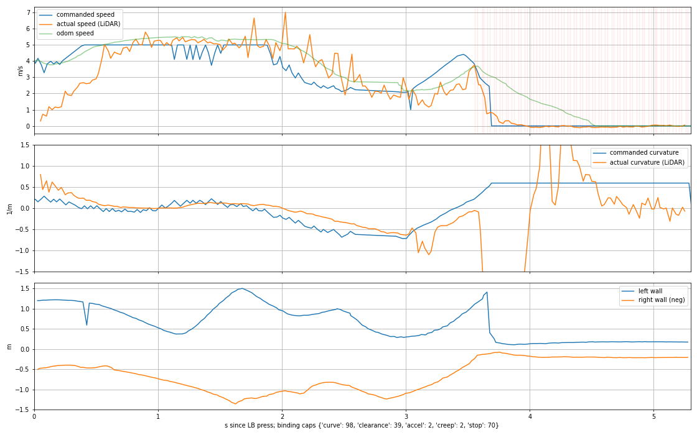

# Run analysis: 20261109-190202

events.jsonl: {'armed': 1, 'first_message': 5, 'deadman': 2, 'status': 1, 'closing': 1}

## LB hold 1: 5.3 s

- held 5.3 s, 189 drive commands (35.7 Hz)
- odometry distance 16.5 m, mean 3.12 m/s, peak 5.52 m/s
- zero-speed commands: 65 ticks (1.62 s)

### How the car responded

```
speed lag 0.050 s (RMS speed error 1.08 m/s at that lag)
steering lag 0.200 s, curvature gain 0.921 (left 1.501, right 0.915; RMS 0.239 1/m)
achieved lateral accel p50/p90/p99: 1.14 / 3.06 / 6.30 m/s^2
grip (achieved / commanded curvature, by commanded lateral accel):
  0.3-1.0 m/s^2: n=   6 ratio 1.556
  1.0-1.5 m/s^2: n=   8 ratio 1.279
  1.5-2.0 m/s^2: n=   8 ratio 0.947
  2.0-2.5 m/s^2: n=   9 ratio 0.914
  2.5-3.0 m/s^2: n=   5 ratio 0.876
  3.0-5.0 m/s^2: n=  22 ratio 0.666
odom speed scale (LiDAR / odom, by curvature):
  |k| 0.0-0.1 1/m: n=  58 ratio 0.945
  |k| 0.1-0.3 1/m: n=  36 ratio 0.941
  |k| 0.3-0.6 1/m: n=  43 ratio 0.784
  |k| 0.6-2.0 1/m: n=  18 ratio 0.390
```

### Replay through gap_mirror (shipped YAML)

- replayed 211 ticks, 180 paired with a published /drive
- steering error RMS 0.1674 rad, max 0.4332 rad
- speed error median 0.0808 m/s
- zero-speed ticks: replay 66, real 62; only in replay at [3.576, 3.619, 3.628, 3.655], only in real at []

binding speed caps: {'curve': 98, 'clearance': 39, 'accel': 2, 'creep': 2, 'stop': 70}

### Stops

- t=  3.56 s, 70 ticks, emergency_clearance, odom 3.67 m/s



