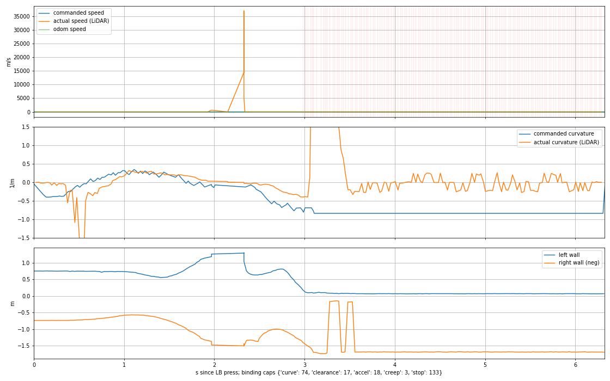

# Run analysis: 20261109-190837

events.jsonl: {'armed': 1, 'first_message': 5, 'status': 2, 'deadman': 2, 'closing': 1}

## LB hold 1: 6.3 s

- held 6.3 s, 231 drive commands (36.5 Hz)
- odometry distance 10.9 m, mean 1.66 m/s, peak 5.39 m/s
- zero-speed commands: 134 ticks (3.35 s)

### How the car responded

```
speed lag 0.475 s (RMS speed error 2567.25 m/s at that lag)
steering lag 0.250 s, curvature gain 0.752 (left 0.892, right 0.671; RMS 0.069 1/m)
achieved lateral accel p50/p90/p99: 0.00 / 3.07 / 477954.08 m/s^2
grip (achieved / commanded curvature, by commanded lateral accel):
  0.3-1.0 m/s^2: n=   5 ratio 0.822
  1.0-1.5 m/s^2: n=   5 ratio 1.415
  1.5-2.0 m/s^2: n=   6 ratio 1.096
  2.0-2.5 m/s^2: n=   5 ratio 0.836
  2.5-3.0 m/s^2: n=   5 ratio 0.799
  3.0-5.0 m/s^2: n=  12 ratio 0.737
odom speed scale (LiDAR / odom, by curvature):
  |k| 0.0-0.1 1/m: n=  29 ratio 0.988
  |k| 0.1-0.3 1/m: n=  51 ratio 0.794
  |k| 0.3-0.6 1/m: n=  15 ratio 0.889
```

### Replay through gap_mirror (shipped YAML)

- replayed 245 ticks, 199 paired with a published /drive
- steering error RMS 0.1213 rad, max 0.4200 rad
- speed error median 0.0000 m/s
- zero-speed ticks: replay 115, real 114; only in replay at [2.964], only in real at []

binding speed caps: {'curve': 74, 'clearance': 17, 'accel': 18, 'creep': 3, 'stop': 133}

### Stops

- t=  2.98 s, 133 ticks, emergency_clearance, odom 3.12 m/s



