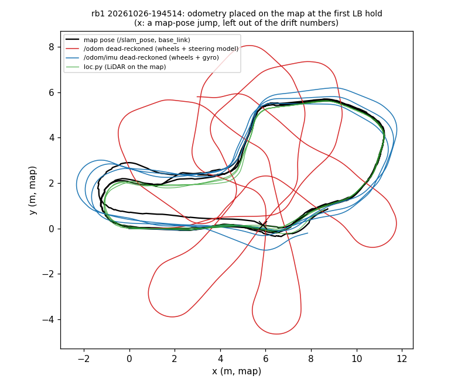
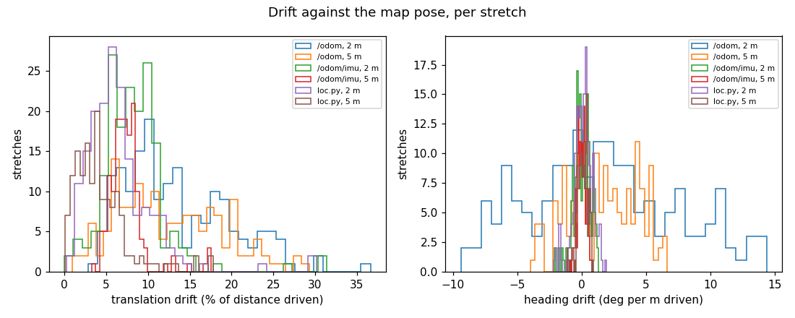
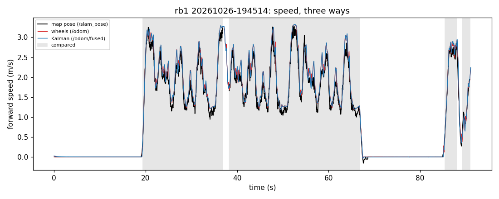
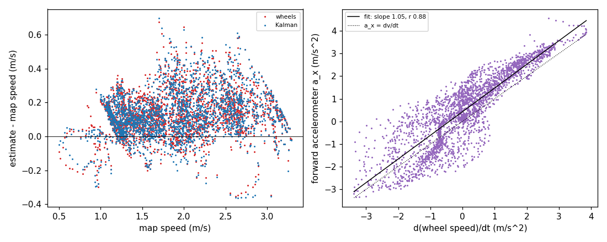
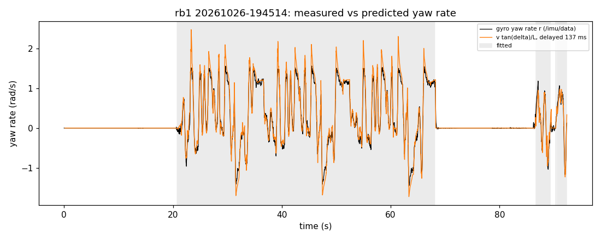
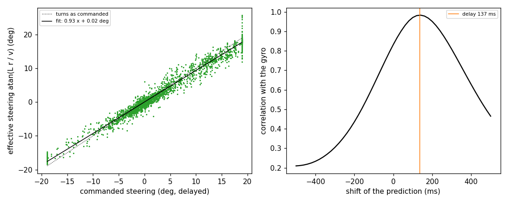
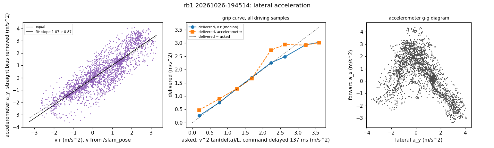
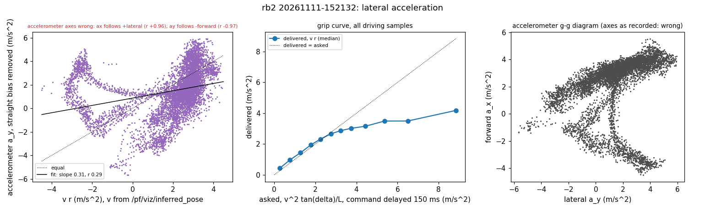
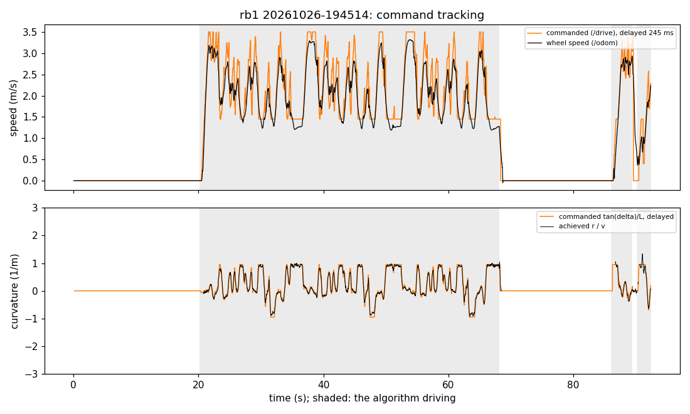
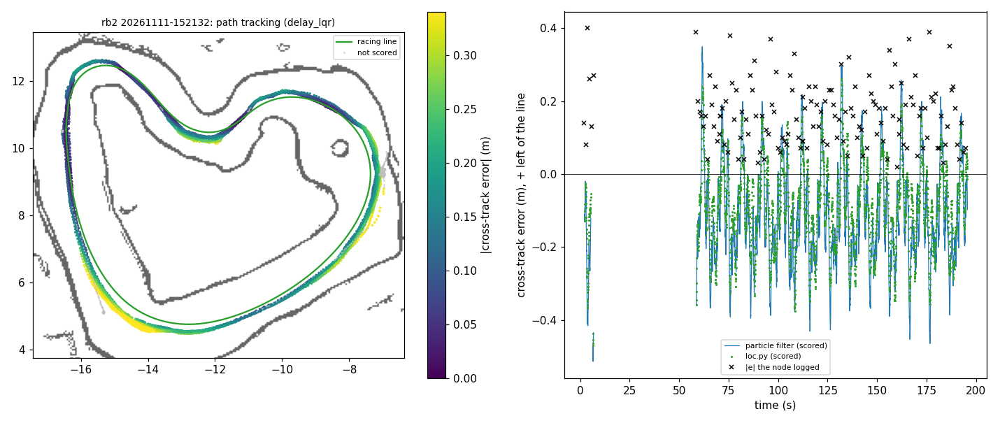

# Dataset examples: what the recorded IMU and driving data can tell you

> **Who this is for:** the software team, or anyone working on state estimation or the race controller (`pure_pursuit_node`) who wants to use recorded runs instead of guessing.
> **Read first:** [run-diagnostics.md, Dataset qualification](run-diagnostics.md#dataset-qualification): how a run gets its `usable` / `conditional` / `unusable` grade for each of the five uses below.
> **You'll be able to:** run one offline analysis per use on any recorded run, read its plots and numbers, and know what they do and do not prove.
> **Time:** 10 minutes to run all five on a run; an hour to read this doc properly.

Every recorded run is graded for five uses. This doc gives one worked example per use.

Each example covers the maths behind it, the recorded topics it needs, and what it measured on a real run. It also says where the measurement stops being trustworthy, and what it means for state estimation or pure pursuit.

The tools are in `tools/run_analysis/dataset_examples/`. They only read recordings. They never change a recording, a parameter or any driving code.

## Highlights

- **One command runs all five on any run**, on a laptop with no ROS installed: about 10 s for a 95 s recording. Results go to a folder outside `data/` (the tool refuses one inside it).
- **Car 1's wheel odometry reads 6.9% far.** Against the SLAM map it counted 1.069 m for every metre driven (run `20261026-194514`). Its steering turned exactly as commanded once that is taken out: slope 0.994.
- **The gyro gives a ten times better heading than the steering model.** On car 1, heading drift was 0.23°/m with the gyro (`/odom/imu`) against 2.19°/m from the steering command (`/odom`).
- **Car 2 understeers at speed.** Above 3.5 m/s it turned only 67% as much as commanded, and on the racing line it ran 0.11 m wide on average (run `20261111-152132`).
- **Three of the four IMUs have their accelerometer axes wrong in `car.yaml`.** The tools detect it from the data and say so instead of printing a wrong number. The gyros, which steering and localization use, are right.
- **Path tracking is checked against the controller's own log.** Pure pursuit logs its pose and cross-track error once a second; this tool's values agree to 5 cm and 1 cm (medians).
- **Every calculation is tested against a closed form.** 37 tests (76 runs, once per car), and 40 of 40 deliberate breaks in `tools/mutations/dataset_examples.json` are caught.

**Why it exists.** The classifier says *whether* a run is good for a use. It does not say what the run shows.

Before this, turning a recording into "the steering delay is 137 ms" meant writing a script from scratch each time. The frames, units and non-driving stretches all had to be got right by hand. These five examples do that once, carefully, so the next person starts from a known-good analysis.

## Contents

- [Before you start](#before-you-start)
- [Running the examples](#running-the-examples)
- [How every example treats the data](#how-every-example-treats-the-data)
- [1. Localization](#1-localization)
- [2. Velocity estimation](#2-velocity-estimation)
- [3. Steering response](#3-steering-response)
- [4. Lateral acceleration](#4-lateral-acceleration)
- [5. Algorithm accuracy](#5-algorithm-accuracy)
- [Findings at a glance](#findings-at-a-glance)
- [Tests](#tests)

## Before you start

- [ ] **A checkout of this workspace with `data/`.** The runs are in `data/<car>/racerbot_runs/<time>/`.
- [ ] **Python 3 with `numpy`, `scipy`, `pyyaml`, `Pillow` and `matplotlib`.** Without matplotlib you still get every number, just no plots.
- [ ] **A way to read bags.** Either ROS 2 Jazzy sourced, or `pip install rosbags==0.10.11` (no ROS needed).
- [ ] **A run graded `usable` for the use you want.** Open `data/dataset_inventory.csv` and filter that use's column. A `conditional` run works too; read its reason first.

## Running the examples

**Terminal: any, from the workspace root.** Nothing here starts a [node](glossary.md#node), publishes anything, or moves the car.

```bash
# All five at once (reads the bag once). --map adds loc.py to the localization example.
python3 tools/run_analysis/dataset_examples/run_all.py data/rb1/racerbot_runs/20261026-194514 \
    --map data/rb1/racerbot_auto/20261026-194514-clean

# A pure pursuit run: path tracking finds the run's own racing line and map by itself.
python3 tools/run_analysis/dataset_examples/run_all.py data/rb2/racerbot_runs/20261111-152132 \
    --map data/rb2/racerbot_auto/20261111-151026-rebuilt

# Or one example at a time, the same way:
python3 tools/run_analysis/dataset_examples/steering_response.py data/rb1/racerbot_runs/20261026-194514
```

The five scripts are `localization.py`, `velocity_estimation.py`, `steering_response.py`, `lateral_acceleration.py` and `algorithm_accuracy.py`. Each takes `--out <folder>` (default `~/.cache/racerbot/dataset_examples/`) and `--help`.

**Working when:** each example prints a short block of numbers, and the last line names the results folder:

```text
steering_response  rb1/20261026-194514  52 s fitted (LB held, >= 0.5 m/s)
  delay 137 ms (correlation 0.983), yaw gain 0.876
  ...
results: ~/.cache/racerbot/dataset_examples/rb1-20261026-194514 (8 plots, summary.json)
```

That folder holds the plots (PNG) and `summary.json`, every number by example, so two runs can be compared with a script.

**If an example says `skipped, the run has no ...`:** that run did not record the [topic](glossary.md#topic) the example needs. Pick another run, or see each example's topic table below.

**If it fails with `No module named 'rosbags'`:** install it, or source ROS first.

## How every example treats the data

These rules are shared (`tools/run_analysis/dataset_examples/common.py`), so all five examples mean the same thing by "driving" or "the map pose".

| Rule | What it does | Why |
|---|---|---|
| **One time base** | Signals are resampled to 50 Hz using the time the bag received each message. A gap over 0.1 s stays a gap (`NaN`), never filled in. | Topics arrive at different rates. Receive time is what every tool in `tools/run_analysis` uses. |
| **Driving** | LB held (the [deadman](glossary.md#deadman)), using the same hold detection and 0.5 s minimum as the grades, and the car moving at 0.3 m/s or more. | Stopped and hand-carried stretches tell you nothing about driving. |
| **The map pose** | SLAM's `/slam_pose` if the run has it, else the [particle filter](glossary.md#particle-filter)'s `/pf/viz/inferred_pose`. Both are moved to the rear axle (`base_link`). | The particle filter reports the LiDAR's position, 0.26 m ahead of the rear axle. Pure pursuit moves it back the same way (`racing_math.laser_pose_to_base_link`). |
| **Pose jumps** | A map-pose step 0.3 m longer than the wheels allow, or 15° more turn than the gyro allows, is a jump. Everything within 0.5 s of one is left out. | A relocalization or loop closure is not motion; it would look like a huge error. |
| **Map speed** | Speed taken from the map pose: its forward velocity over a centred 0.4 s window. Used wherever a run has a map pose. | Wheel speed can read several per cent high (example 2). The map pose does not depend on the wheels. |
| **Accelerometer axis check** | Before using the accelerometer, check that its x axis follows the change of speed and its y axis follows speed × yaw rate. If not, print a warning instead of a result. | A mount rotation set wrong in `src/racerbot_car/cars/<car>/imu/car.yaml` puts the wrong acceleration on each axis (see [findings](#findings-at-a-glance)). |

A note on words. **Measured** means read straight from a sensor (the gyro, the accelerometer, the LiDAR). **Predicted** means computed from a model (the bicycle model below). **The map pose** is an estimate too, from SLAM or the particle filter; it is the best reference the recordings have, not the truth.

---

## 1. Localization

**The question:** how far does the car's own [odometry](glossary.md#odometry--odom) drift, compared with where the map says the car is? That drift is what the particle filter or SLAM has to keep correcting.

**Topics**

| Topic | What it is | Variable |
|---|---|---|
| `/odom` | VESC odometry: wheel speed, heading from the steering command | x, y (m), yaw (rad), in the `odom` frame |
| `/odom/imu` | `imu_bridge`'s gyro odometry: the same wheel distance, heading from the gyro | x, y, yaw, in the `odom_imu` frame |
| `/slam_pose` or `/pf/viz/inferred_pose` | the map pose (reference) | x, y, yaw in `map` |
| `/imu/data`, `/joy` | gyro for jump detection; LB for driving | rad/s; button |

**Model.** Odometry is only trusted over short distances, so it is compared one stretch at a time (2 m and 5 m of driving). For a stretch from sample *i* to *j*, each source's motion is written in the car's own frame at *i*, which removes any difference between the `odom` and `map` frames:

```text
ΔT = T(i)⁻¹ · T(j)                      (dx, dy, dyaw in base_link at i)
translation drift = |Δp_odom − Δp_map| / distance driven    (%)
heading drift     = (dyaw_odom − dyaw_map) / distance driven  (°/m)
```

A stretch is used only if every sample in it is driving and none is near a jump.

**Result: car 1, `20261026-194514`** (103 m, reference `/slam_pose`, 1 SLAM jump left out)

| Source | Over 5 m: translation drift (median, p95) | Heading drift (median) |
|---|---|---|
| `/odom` (steering model) | 11.6%, 23.3% | 2.19 °/m |
| `/odom/imu` (gyro) | 7.2%, 10.7% | **0.23 °/m** |





The red path (`/odom`, heading from the steering model) wanders off within a lap. The blue one (`/odom/imu`, heading from the gyro) keeps the shape but is stretched: that is the wheel-speed scale error found in example 2. On car 2's race run (441 m, particle filter), the same pattern: 3.59 against 0.35 °/m, and 19.1% against 5.6%.

**loc.py as a second estimate.** With `--map`, `tools/run_analysis/loc.py` matches every LiDAR scan against the run's map, independently of SLAM and the wheels (the map-pose path only tells it where to start searching). It is a second estimate, not ground truth.

- **The frames match.** If loc.py and the map pose were in different frames, the best rotation and shift would line their tracks up and leave little behind. They leave as much as before (car 1: 0.17 m of 0.15 m; car 2: 0.10 m of 0.09 m), so there is no frame offset. What is left is the two estimates disagreeing.
- **How far apart:** median 0.15 m on car 1 (against live SLAM, whose heading also differs by 2.3°) and 0.09 m on car 2 (against the particle filter on a fixed map).

**Limitations**

- The map pose is an estimate. Drift is measured against it, so its own error (about 0.1 m, from loc.py) is in every number.
- One run per car, on one floor. Drift depends on the surface and on speed.
- Only drift over 2 and 5 m is measured. Longer drift grows faster than linearly once heading error builds up.

**What it means for downstream work**

- **State estimation:** heading from the gyro is about ten times better than heading from the steering command, on both cars. That supports the existing choice of `odom_imu` for SLAM (decision 14 in CLAUDE.md). The remaining 5–7% translation drift is the wheel-speed scale, not heading.
- **Particle filter:** the drift per metre is a direct measure of how much its motion model has to spread particles. 7% per metre is a lot; fixing the wheel scale would shrink it.
- **Pure pursuit:** it steers from the map pose, not from odometry. Odometry drift only matters to it between localization updates and after a jump (2 jumps in 441 m on car 2's run).

---

## 2. Velocity estimation

**The question:** how close is the wheel speed to the car's real speed, and does the accelerometer agree with it?

**Topics**

| Topic | What it is | Variable |
|---|---|---|
| `/odom` | wheel speed: motor ERPM ÷ `speed_to_erpm_gain` | v_wheel (m/s) |
| `/odom/fused` | `imu_bridge`'s Kalman blend of wheel speed and accelerometer, clamped to ±0.3 m/s of the wheel speed | v_fused (m/s) |
| the map pose | reference | x, y, yaw → v_map (m/s) |
| `/imu/data` | calibrated accelerometer, car axes | a_x (m/s²) |

**Model**

```text
v_map  = (dx·cos yaw + dy·sin yaw) / dt        forward speed of the map pose, over 0.4 s
error  = v_wheel − v_map                        on samples driving at ≥ 0.5 m/s
distance ratio = Σ v_wheel / Σ v_map            1.00 if the wheel scale is right
a_x    = dv/dt                                  on level ground
```

**Result: car 1, `20261026-194514`** (50 s compared)

| | Mean error (bias) | RMS | Distance ratio |
|---|---|---|---|
| Wheel speed | +0.13 m/s | 0.19 m/s | **1.069** |
| Kalman `/odom/fused` | +0.13 m/s | 0.19 m/s | 1.069 |
| Accelerometer a_x against d(v_wheel)/dt | slope 1.05, r = 0.88, offset 0.50 m/s² | | |





The wheels count 6.9% more distance than the car covers. Car 1's gain was −4040 in this run and still is.

The Kalman speed inherits the same error. An accelerometer measures changes in speed, so it cannot correct a constant scale.

The accelerometer follows the wheel acceleration well. Its 0.5 m/s² offset is about what a 3° pitch of the mount gives (9.81 × sin 3° = 0.51).

On car 2's race run the wheel scale is closer (ratio 1.024), but its RMS error is larger (0.40 m/s), and its accelerometer cannot be checked: its axes are rotated (see [findings](#findings-at-a-glance)).

**Limitations**

- The map speed comes from differentiating a pose estimate, so it is noisy (centimetres of pose noise over 0.4 s) and only used above 0.5 m/s.
- SLAM's own scale is taken as right. It comes from LiDAR ranges, which are metric, but it is not independently checked here.
- Wheel slip and the scale error look the same over a short window; over a whole run, the ratio is the scale.

**What it means for downstream work**

- **State estimation:** a speed estimator that fuses only wheels and an accelerometer will carry the wheel's scale error. The correction has to come from something that measures distance: the map pose, LiDAR, or a recalibrated gain (the [odometry calibration wizard](odom-calibration.md) exists for this).
- **Pure pursuit:** it scales its [lookahead](glossary.md#lookahead) with speed, and tracks its speed profile against the wheel speed. A 7% scale error also leaks into every model that uses v, as examples 3 and 4 show.

---

## 3. Steering response

**The question:** for a given steering command, how does the car actually turn, and how long does it take?

**Topics**

| Topic | What it is | Variable |
|---|---|---|
| `/ackermann_cmd` | steering after `ackermann_mux`: what reached the VESC | δ_cmd (rad) |
| `/odom` | wheel speed | v (m/s) |
| `/imu/data` | calibrated gyro, car z axis | r, yaw rate (rad/s) |
| `/steering/measured` | `vehicle_state_node`'s own steering estimate (consistency check) | rad |

**Model:** the kinematic bicycle (rear axle reference, wheelbase L = 0.36 m):

```text
predicted yaw rate   r̂ = v · tan(δ_cmd) / L
effective steering   δ_eff = atan(L · r / v)        what the gyro says the car steered
```

Fitted from these:

- **Delay:** the time shift of r̂ that best lines it up with r (cross-correlation, `yaw_tracking.xcorr_lag`). It covers servo travel, tyre build-up and message transport.
- **Yaw gain:** r ≈ k · r̂ after the shift. 1.0 if the model is right.
- **Steering map:** δ_eff = a · δ_cmd + b. a = 1 and b = 0 if the servo calibration is right; b is the straight-ahead offset.

**Result: car 1, `20261026-194514`** (52 s fitted)

| | With wheel speed | With map speed |
|---|---|---|
| Delay | 137 ms (correlation 0.98) | |
| Yaw gain | 0.876 | **0.988** |
| Steering map slope a | 0.932 | **0.994** |
| Straight-ahead offset b | 0.02° | |
| Turned / commanded, 0.5–1.5 / 1.5–2.5 / 2.5–3.5 m/s | | 1.02 / 0.98 / 1.05 |





With the wheel speed, the steering seems 7% weak. With the map speed, the gain is 0.99: the bicycle model and car 1's servo calibration are right, and the apparent weakness was the wheel scale from example 2. The flat band at ±19° in the scatter plot is the steering limit (0.33 rad on car 1).

**Car 2's race run (`20261111-152132`) is different.** With map speed, the slope is 0.886. Split by speed, it falls from 1.10 below 1.5 m/s to **0.67 above 3.5 m/s**. Its delay is 149 ms.

A servo calibration error would be the same at every speed. One that grows with speed is tyre slip, called understeer: the faster the car goes, the less it turns for the same command.

**Limitations**

- δ_eff uses v, so it inherits whichever speed is used. Hence the two columns.
- The delay is measured on receive times, so it includes message transport.
- Below 0.5 m/s, δ_eff is mostly gyro noise and is not used.
- Understeer and a soft servo cannot be separated with one fast run alone; the by-speed split is what does it.

**What it means for downstream work**

- **Pure pursuit:** its steering law assumes exactly this bicycle model. On car 1 the model holds within 1–2% up to 3.5 m/s. On car 2 at racing speed the car turns a third less than pure pursuit expects, so it will run wide in fast corners, which example 5 confirms.
- **Delay:** 137–149 ms, against 125 ms assumed by the `delay_lqr` law (75 ms actuation + 50 ms sensing). At 4 m/s the car travels about 0.55 m before a steering command takes effect. That is close to the 0.6 m minimum lookahead (`min_lookahead`).
- **State estimation:** `/odom` predicts heading with this same model, from the command. Its 2.2–3.6 °/m heading drift (example 1) is this model's error, integrated.

---

## 4. Lateral acceleration

**The question:** how hard does the car really corner, and how much grip is there?

**Topics**

| Topic | What it is | Variable |
|---|---|---|
| `/imu/data` | gyro z; accelerometer y | r (rad/s); a_y (m/s²) |
| map pose, else `/odom` | speed | v (m/s) |
| `/ackermann_cmd` | steering | δ (rad) |

**Model:** a car going round a corner accelerates sideways, towards the centre:

```text
from the gyro           a_y = v · r                 the reference: on any corner, this IS the centripetal acceleration
from the steering       a_y = v² · tan(δ) / L       what the command asks for
from the accelerometer  a_y = /imu/data's y axis    also reads g·sin(roll); straight-line median removed first
```

The **grip curve** plots delivered (v · r) against asked (v² tan δ / L), binned with `grip_truth.curve()`. The command is first shifted by the steering delay from example 3. The **sustained limit** is the highest bin with at least 1 s of data (`grip_truth.sustained_limit`).

`grip_truth.py` itself uses only steady corners. These courses rarely hold one long enough (30 steady samples on car 1's run, 12 on car 2's), so all driving samples are used instead.

**Result: car 1, `20261026-194514`**

| | |
|---|---|
| p95 of v · r | 2.44 m/s² (27.6 s above 1 m/s²) |
| Accelerometer against v · r | slope 1.07, r = 0.87 (0.25 m/s² straight-line bias removed) |
| Sustained limit | **2.49 m/s²**, when the command asked about 2.75 |



**Car 2's race run** pushed harder: delivered acceleration flattens at **3.49 m/s²** while the command asks for up to 7. That flat top is the grip limit. Its accelerometer is flagged instead of fitted, because its axes are wrong:



**Limitations**

- The sustained limit is the most the car *did* sustain on that run, on that floor, with those tyres. A gentler run gives a lower number without the car having less grip: car 1's run was gap follow at up to 3.3 m/s.
- v · r assumes no sideslip of the rear axle. That holds until the rear slides.
- The accelerometer reads body roll too (g · sin roll), so it is a check on v · r, not a replacement.

**What it means for downstream work**

- **Pure pursuit:** its speed profile caps speed at v = √(a_max / |κ|), with `max_lateral_accel` = 2.5 m/s² shipped and 3.1 on car 2. Car 2 measured 3.5 at saturation. This tool gives the evidence for that number; it does not change it.
- **State estimation:** where the accelerometer is mounted right, the gap between it and v · r is a slip signal. That needs the axis problem fixed first on car 2 and on both VESC IMUs.

---

## 5. Algorithm accuracy

Two separate results, because they answer different questions and must not be confused:

- **Command tracking:** did the car do what the algorithm told it? Possible on every run.
- **Path tracking:** how far was the car from the line it was told to follow? Only possible when the run followed a recorded racing line.

A run without a racing line (gap follow, mapping) gets command tracking only. The tool then says so in its output: "command-tracking results only, not path-tracking accuracy".

### 5a. Command tracking

**Topics:** `/drive` (the algorithm's own command: speed, steering), `/odom`, `/imu/data`, `/joy`, `/drive_intent` (to know when the algorithm was driving rather than stopped).

**Model**

```text
speed:      v_wheel(t)  against  v_cmd(t − τ_v)           command held between messages
curvature:  κ = r / v   against  κ_cmd = tan(δ_cmd) / L   (v ≥ 0.5 m/s)
```

Each delay τ is the shift that best lines the two up. Scored only while LB is held and the algorithm's `/drive_intent` is not `stop`.

**Result: car 1, `20261026-194514`** (gap follow, 53 s)

| | Delay | Error | Ratio / gain |
|---|---|---|---|
| Speed | 245 ms | mean −0.18 m/s, RMS 0.34 m/s | achieved / commanded 0.92 |
| Curvature | 139 ms | RMS 0.078 /m | gain 0.93 (0.996 with map speed) |



Car 2's race run: speed delay 248 ms, ratio 1.05; curvature delay 151 ms, gain 0.89 with map speed (the understeer of example 3).

### 5b. Path tracking

**Run:** car 2, `20261111-152132`: `pure_pursuit_node` with the **`delay_lqr`** steering law, 423 m. No recorded run used the default geometric `pure_pursuit` law, so this result describes `delay_lqr`. The same command scores a geometric-law run unchanged.

**Topics:** `/pf/viz/inferred_pose` (car position), `/drive_intent` (tracking or not), `/odom`, `/imu/data`, `/joy`, `/rosout` (the node's own log), plus the run's `metadata/params/`.

**Model:** cross-track error e is the signed distance from the rear axle to the closest point of the closed [racing line](glossary.md#racing-line). It is positive when the car is left of the line's direction of travel, the workspace convention (`racing_math.project_onto_path`). Every segment is checked, so a hairpin cannot pick the wrong side.

**Checks that the line, map and frames are really this run's.** The tool prints each one:

| Check | How | This run |
|---|---|---|
| The line is the one the run loaded | the node's `waypoints_file` parameter in `metadata/params/pure_pursuit_node.yaml` | ✅ `racerbot_auto/20261111-151026-rebuilt/raceline_profiled.csv` |
| Same content | the node's `/rosout` line `ready: 186 waypoints from '...'` against the file's row count | ✅ 186 = 186 |
| Same map | `map_server`'s `yaml_filename` is in the line's folder | ✅ |
| Frames | pose topic in `map`; `pose_frame: laser` → moved 0.26 m to the rear axle, exactly as the node does | ✅ |
| Same answer as the controller | the node logs its own rear-axle pose and cross-track error once a second | ✅ 5 cm and 1 cm apart (medians, 146 log lines) |

**What is not scored:** time when the node was not tracking (`deadman_released`, `body_contact`, `lidar_avoidance`), LB released, the car under 0.3 m/s, and 0.5 s around each particle-filter jump. The tool reports how much of each it left out (here: 1 s released while moving, 1 s near 2 jumps).

**Result** (140 s scored)

| | Mean | RMS | p95 \|e\| | Max \|e\| |
|---|---|---|---|---|
| All | −0.11 m | **0.18 m** | 0.34 m | 0.51 m |
| Straights (\|κ\| < 0.3 /m) | −0.13 m | 0.17 m | 0.31 m | 0.51 m |
| Corners | −0.11 m | 0.19 m | 0.35 m | 0.47 m |
| loc.py as the position (second estimate) | | 0.15 m | 0.29 m | |



The car runs this loop counter-clockwise, so negative means **outside** the line. It runs wide in the corners and drifts outside after them, consistent with the understeer measured in example 3. Speed against the line's own speed profile: mean +0.04 m/s, RMS 0.33 m/s.

**Limitations**

- The car's position is the particle filter's estimate, so e includes localization error. loc.py, an independent LiDAR match, puts the two 0.10 m apart (median) and gives a slightly smaller RMS (0.15 m). Read e as ±0.1 m.
- One run, one line, one steering law (`delay_lqr`).
- The line folder was committed to git after the run (on 2026-11-21) and never changed. The node's logged waypoint count matches it, but a byte-for-byte check was not possible, because the run recorded no file hash.

**What it means for downstream work**

- **Pure pursuit:** 0.18 m RMS, biased 0.11 m outward, is the number to beat. The bias, not the scatter, is the bigger part, and it matches car 2's understeer. A tracking law that accounts for understeer, or a lower corner speed, should move the mean towards zero; this tool will show whether it did.
- **Command tracking is not path tracking.** A car can follow its commands closely and still miss the line, if the line or the localization is off. Keep the two separate when comparing algorithms.

---

## Findings at a glance

| Finding | Evidence | Matters for |
|---|---|---|
| Car 1's wheels read 6.9% far (gain −4040, unchanged since) | distance ratio 1.069, matched by 7% translation drift | speed estimation, lookahead, every v-based model |
| Gyro heading ≈ 10× better than steering-model heading | 0.23 against 2.19 °/m (car 1), 0.35 against 3.59 (car 2) | localization, SLAM input |
| Car 1 steers as commanded | slope 0.994, gain 0.988 with map speed | pure pursuit model |
| Car 2 understeers at speed | turned / commanded 0.67 above 3.5 m/s; runs 0.11 m wide | pure pursuit, corner speed |
| Steering delay 137–149 ms, speed delay ≈ 245 ms | cross-correlation peaks, r ≥ 0.97 for steering | lookahead, delay compensation |
| Grip ≈ 2.5 (car 1, gap follow) and 3.5 m/s² (car 2, at saturation) | grip curves | `max_lateral_accel` |
| **Accelerometer axes wrong on 3 of 4 IMUs** | car 1 VESC and car 2 VESC: x and y both inverted (a 180° yaw error); car 2 BNO085: rotated 90°. Its `car.yaml` yaw is 0.24° because roll and pitch were set from gravity, which cannot measure yaw. Car 1's BNO085 is right. | `vehicle_state_node` takes forward acceleration from the BNO085: on car 2 that axis carries lateral acceleration. The ±0.3 m/s clamp limits the damage. |

The accelerometer finding is reported, not fixed here: the mounts are in `src/racerbot_car/cars/<car>/imu/car.yaml`, calibrated with `tools/imu_calibration/`. The gyros, which steering, localization and `/odom/imu` use, are correct on every IMU.

<details>
<summary><strong>How the accelerometer axes were checked</strong> (safe to skip)</summary>

For each IMU, the forward channel a_x should follow the change of wheel speed, and the lateral channel a_y should follow speed × gyro yaw rate. Correlations on the two runs, while driving:

| IMU | a_x vs forward | a_x vs lateral | a_y vs forward | a_y vs lateral |
|---|---|---|---|---|
| car 1 BNO085 | **+0.87** | −0.39 | −0.40 | **+0.87** |
| car 1 VESC | **−0.88** | +0.40 | +0.15 | **−0.94** |
| car 2 BNO085 | −0.34 | **+0.97** | **−0.98** | +0.24 |
| car 2 VESC | **−0.99** | +0.33 | +0.25 | **−0.99** |

Car 1's BNO085 is the control: both channels follow what they should, with the right sign, which shows the test itself is sound. `common.accel_axes()` applies the same test to whichever IMU `/imu/data` is, and needs |r| ≥ 0.7 with the right sign on both channels.

</details>

## Tests

Runner: `python3 -m pytest tools/run_analysis/tests/` (the tool suites, no ROS needed). The examples' tests are in `test_dataset_examples.py`: 37 tests, each run once per car.

Every expected value is a closed form computed in the test. For example:

- a circle's chord speed, for the map speed;
- a 0.12 s delay and 0.9 gain injected into synthetic yaw rates;
- a car 0.2 m outside a 5 m circle, reported as the particle filter would (the LiDAR's pose).

Cross-track error is also checked against pure pursuit's own `racing_math.project_onto_path`, a second, independent implementation. The log parsing is tested on real lines copied from car 2's run.

Hard rule 1 (CLAUDE.md): each of the 40 breaks in `tools/mutations/dataset_examples.json` (a flipped sign, a missing check, a swapped argument) turns the tests red:

```bash
PATH=<python with rosbags, scipy, matplotlib>:$PATH python3 tools/check_mutations.py \
    tools/mutations/dataset_examples.json --no-ros
```

**Working when:** the last line reads `40/40 breaks caught`.

**To add an example:**

1. Put its maths in a pure function next to the others, and take a `Run` from `common.load()`.
2. Use `common`'s driving mask, map pose and jump handling rather than your own.
3. Test the maths against a closed form, and add a break for each rule to the mutation file.
