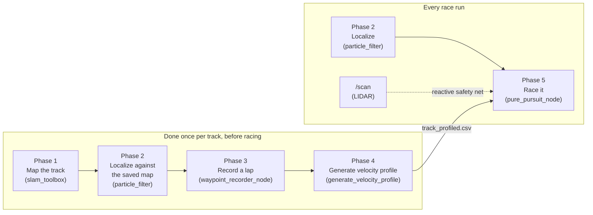

# Racing autonomy: SLAM, localization, and a pure-pursuit race controller

> **Who this is for:** anyone running, tuning, or trying to understand the map-based race stack. It's the biggest doc here, and it opens with a plain-language summary — read that even if you skip the rest.
> **Read first:** [operations.md](operations.md#racing-with-the-pure-pursuit-stack) for how to actually run it, and [architecture.md](architecture.md) for the safety model.
> **You'll be able to:** explain every stage from SLAM to steering command, and tune the stack without guessing.
> **Time:** an hour to read properly. Every derivation is inside a collapsible block you can skip on a first pass.

This is the algorithm reference for `pure_pursuit`: a race stack that drives from a *saved map of the track*.

It's built on top of two things this car already has — mapping, and [localization](glossary.md#localization) (the car working out where on that map it currently is).

This doc is about *why* it's built this way and *how each algorithm works*. The code is written to be read alongside it — `src/pure_pursuit/pure_pursuit/racing_math.py` above all, which holds every formula below with no ROS in the way.

---

## Highlights

- **Maps a brand-new track and races it from one command, with nobody steering.** `auto_map_race_launch.py` drives the car round reactively, detects the closed lap, records and paces a racing line, then hands control to the race controller. No map saving, no offline tooling, no process restarts, no RViz pose seed.
- **Turns a hand-driven lap into a real speed plan.** An offline pass measures how sharply the track turns at every point and works backwards from each corner, so braking starts *before* the corner rather than at it. Nothing about this needs a solver or a dynamics model.
- **Optionally re-derives the fastest line, not just its speed.** The [minimum-curvature optimizer](#phase-4b-optional-optimize-the-line-itself-not-just-its-speed) finds the geometrically fastest path within the track's real width. Against a bare centerline at Brands Hatch: **94.85 s → 92.30 s** — about half the gain of TU Munich's reference implementation, at a clearance margin the reference wasn't holding.
- **Detects and follows traffic from the [LiDAR](glossary.md#lidar).** Map subtraction finds objects absent from the saved map, and tracking estimates their progress along the line. Car 2 follows with a braking-aware speed ceiling; its legacy offset-point passes are disabled by default.
- **Seven independent safety layers, any one of which can stop the car.** They run every control tick, they're ordered, and a stop is published unshaped — no rate limiter can turn a stop into a slow-down. Even an unhandled exception publishes a stop before it propagates.
- **Refuses to race a line the car can't physically steer.** The supervisor checks the generated racing line against the steering rack's real limit and against the map's own walls, and says no with numbers rather than degrading on track. That check exists because every line this car generated for months was unfollowable for a third of its length.
- **The math is a plain library, not a [ROS node](glossary.md#node).** All of it lives in `racing_math.py` with no ROS imports, so `python3 -m pytest src/pure_pursuit/test/ -v` runs the whole thing on a laptop — no robot, no build, no `rclpy`.

**Honest limits:** the velocity profile is a single-number friction model, not vehicle dynamics. Opponent handling reasons about one car at a time, with no identity tracking across occlusions. There's no defensive driving.

Two known latch-ups are documented below rather than hidden — both since fixed, as of 2026-08-25 (the second, `off_racing_line`, was still open when the first pass of this section was written). And a course narrower than about 2.6 m will map and profile cleanly, then still run wide at the first corner, for reasons that are [measured and explained](#how-fast-a-mapped-course-can-actually-be-raced-and-why) rather than mysterious.

### Why it exists

[`gap_follow`](../src/gap_follow/README.md), this car's other driving node, is **reactive**: it looks at the current LiDAR scan, steers at the biggest gap, and repeats — with no memory of the track and no map at all.

That makes it robust and simple. It's also fundamentally short-sighted. It cannot see around a corner, cannot plan a smooth line through an S-curve, and has no notion of "this is a known 90° hairpin, start braking *now*."

On a track you get to drive and map in advance — which is almost every real race — that short-sightedness costs real lap time.

`pure_pursuit` is **map-based**. It knows the whole track in advance as a racing line with a precomputed speed at every point, and it knows exactly where the car is on that line. That lets it brake early, carry more speed through a corner it knows is coming, and drive the same line lap after lap.

The trade-off is honest: it depends on a good map and working localization.

Which is exactly why a LiDAR-based reactive safety net — the same idea `gap_follow` is built on — is still layered underneath it. That net covers everything the map cannot know about: an opponent's car, a spun-out car, debris.

---

## The 60-second version

Skip the equations for a moment. Here's the whole system in plain language, the way you'd explain it to someone who has never touched ROS:

- **Mapping.** Drive the track once — by hand, or let the car do it *itself*, reactively, with nobody touching the steering — so the car ends up with a picture of where the walls are. This is [SLAM](glossary.md#slam): the car draws the map and works out where it is on it, at the same time, from nothing but its own laser scans.
- **Localization.** The car constantly compares what its [LiDAR](glossary.md#lidar) (its spinning laser rangefinder) sees right now against that picture, to work out "where am I, exactly." Like finding your spot on a paper map by matching the shape of the room around you to the shape drawn on the page.
- **Recording a line, then pacing it.** Drive one good lap. A small program then looks at how sharply the track turns everywhere, and works out a sensible speed for every point on it. Slow for tight corners, fast on straights, braking that starts *before* the corner.
- **Driving it.** Imagine picking a spot a little way ahead on the track — the **lookahead point** — and steering toward it, over and over. Go faster or slower depending on how fast you're supposed to be right there. That is the entire control algorithm. It's called **Pure Pursuit**, and that's genuinely all it is.
- **Handling other cars.** Detect and confirm a car, then estimate its position and speed along the racing line. Car 2 lowers its speed so it can brake behind it while retaining its normal steering law. The legacy offset passing behaviour is described separately below.
- **Safety, always on top.** No matter what any of the above wants to do, if something gets too close for comfort the car stops or steers around it first and asks questions later. And none of it moves an inch unless a human is holding the LB button.

Everything past this point explains *why* each piece works the way it does, with the actual math. That's useful once you want to tune it, extend it, or just understand it properly — but it isn't required to get the gist.

Two words worth pinning down before you go further, because the rest of the doc leans on them:

- A **racing line** is the specific path around the track you want the car to follow — stored here as a plain list of `(x, y)` points, and after pacing, `(x, y, speed)`. It is not the centre of the track; it's wherever you decided is fast.
- A **velocity profile** is that same list of points with a target speed attached to each one. Generating it is [Phase 4](#phase-4-generate-the-velocity-profile).

---

## Minimum-time racing line

`map_course` and `tools/run_analysis/rebuild_run.py` use one offline builder for both cars. After the mapping launch shuts down, it compares the cleaned recorded path, a minimum-curvature path (gentler corners) and a minimum-time path (the lowest estimated lap time). The default `race_line_mode: fastest` selects the fastest candidate that passes the checks.

The builder checks the closed-loop final waypoints against the car's steering limit, mapped body clearance and forward-cone clearance. The cone must remain beyond the controller's effective `emergency_stop_distance` plus a 0.10 m planning margin. These checks do not alter the controller's safety thresholds.

Configuration loads shared `auto_map_race.yaml`, then the selected car's calibration. Car 1 has no supervisor overlay. The principal physics values are:

| Planning value | Car 1 | Car 2 |
|---|---|---|
| Steering limit | 0.30 rad | 0.38 rad, below its 0.42 rad controller cap |
| Lateral acceleration, left and right | 2.5 m/s² | 3.2 m/s² |
| Acceleration / braking | 6.0 / 3.0 m/s² | 4.0 / 3.0 m/s² |
| Wheel angle / commanded angle | 1.0 | 0.99 |

Both use a 5.0 m/s speed ceiling, a 1.0 rad/s steering-rate limit and a 0.10 s steering delay. Planned speed delay is 0.10 s on car 1 and 0.22 s on car 2.

Shared margins are 0.15 m for optimization walls and 0.10 m for the forward cone. The body-clearance floor rises from 0.22 m to 0.30 m near tight corners; see [the car 2 results](#how-the-map-racer-beats-gap_follow-on-car-2).

Car 2's calibration cites `car_measure.py` over runs `20261106-163633`, `170803` and `171030`; see [Hardware reference](hardware-reference.md).

On success the builder writes `raceline_profiled.csv`, an identical path capped at 1.5 m/s in `raceline_floor_test.csv`, and candidate verdicts in `race_line.json`. Rebuilds also record the selected car, effective parameters and candidate metrics in `rebuild.json`.

`map_course` prints a one-line result; on builder failure it restores the node's original profile and says why. A rebuild with no acceptable candidate writes no raceable profile.

**Terminal 2, after mapping has shut down:** to rebuild a saved mapping folder manually, set `RUN_DIR` to the `Saved in:` path, then run:

```bash
python3 -m pure_pursuit.race_line --run-dir "$RUN_DIR"
```

**Working when:** the last result line starts `choice:` and names the selected source, and both CSV files exist.

`--car rb1` or `--car rb2` selects a car explicitly when working offline; otherwise the tool uses the current car. `race_line_mode` can also require `recorded`, `min_curvature` or `min_time`; a required mode refuses a failed candidate instead of choosing another source.

### Limitations

This chooses the lowest estimated time among the accepted candidates, not a proven global optimum. Earlier car 2 trials at 2.9 m/s² and 0.38 rad gave 10.97–11.10 s on 06a and 9.15–9.40 s on 06b, three seeds each with no contact.

Those earlier trials did not beat the corresponding `gap_follow` times of 11.35 / 8.46 s on both courses. Planning at 0.42 rad caused contact or wedging. The current comparison below uses the measured 6 Nov floor and the 0.42 rad controller cap, with planning still limited to 0.38 rad.

**Follow the static checks, wheels-off-the-ground check and capped floor test before using the default-speed line. Keep LB held to drive.** These defaults have simulator evidence only.

The driving supervisor still writes its own profile; minimum-time optimization never runs inside a driving node. The continuous map-and-race launch below therefore uses the supervisor's existing profiling path.

## How the map racer beats gap_follow on car 2

**Simulator-validated only, not driven on the car.** With the shipped builder and car 2 settings, the map racer beats the supplied `gap_follow` reference at its shipped 5 m/s ceiling on both 6 Nov courses.

Four changes work together. Selecting a different steering law alone did not solve the earlier contacts:

1. **Predict steering delay to remove the weave.** Car 2 now selects `delay_lqr` through `cars/rb2/tuning/pure_pursuit.yaml`. It predicts through the old position estimate, command transport and servo lag instead of correcting an error the car has already passed. Car 1 keeps `pure_pursuit`.
2. **Let the braking ramp follow a falling target.** The old ramp basis used measured speed even when the profile asked for less. Each command stayed only one slew step below that speed, giving about 1.4 m/s² braking where the plan expected 3.0 m/s².

   The node and simulator now cap the basis at the target, so falling commands ramp down from the last command without being held up by measured speed.
3. **Leave room for tracking error near walls.** `race_line_body_floor` is 0.22 m and `race_line_body_floor_tight` is 0.30 m. `min_time_line.body_floor_at` raises the required room as curvature approaches the planning steering limit and holds that requirement for 0.6 m either side. A line that clears a wall exactly can still hit it when the car tracks slightly wide.
4. **Separate planning grip from the tight-corner ceiling.** Car 2 plans with 3.2 m/s² lateral acceleration and `profile_speed_delay: 0.22` s, allowing for command transport and speed-loop response.

   The controller's `max_lateral_accel: 2.7` m/s² slows full-lock turns; 2.9 m/s² wedged at the 06b hairpin. The planning value is a floor-model fit, not a claim that the car achieves 3.2 m/s² in every corner.

### Shipped-path verification, 2026-11-08

The inputs were read-only copies of `map.yaml`, `map.pgm` and `raceline_raw.csv` from car 2's rebuilt runs `20261106-164002-rebuilt` (06a) and `20261106-184753-rebuilt` (06b).

The shipped `python3 -m pure_pursuit.race_line --run-dir "$RUN_DIR" --car rb2` built each copy. Its `race_line.json` reported these candidates; estimates are planning costs, not measured lap times:

| Course | Recorded estimate / verdict | Minimum-curvature estimate / verdict | Minimum-time estimate / verdict | Choice / minimum body clearance |
|---|---|---|---|---|
| 06a | 11.595 s / refused: body | 10.530 s / refused: cone and body | 10.581 s / accepted | `min_time` / 0.2500 m |
| 06b | 8.682 s / refused: body and curvature | 8.818 s / refused: cone and body | 8.039 s / accepted | `min_time` / 0.2500 m |

The first shipped-path check refused every 06b candidate: its minimum-time line missed the body floor by 0.0138 m at the final 0.15 m waypoints.

Commit `b5f6427` allows up to four retries after the first attempt, asking for 0.01 m more body room and 0.03 m more cone margin per retry. Final checks retain the configured limits.

The optimizer's own stations are 0.25 m apart, so passing there does not guarantee passing the denser final check.

Each selected `raceline_profiled.csv` ran on `sfu_course_2026_11_06`, using tracks `car2_course_2026_11_06a_scans` and `car2_course_2026_11_06b_scans`. Settings were `--profiled --safety map --laps 4 --steering-limit 0.42 --speed 5.0 --lateral 2.7 --timeout 70 --law delay_lqr`, with `RACERBOT_CAR=rb2` and seeds 12345–12350.

A **flying lap** is lap 2, 3 or 4, after the standing start. Each row pools 18 flying laps. Contact and stop ticks cover all four laps; cross-track error is distance sideways from the line. The last column gives the largest run maximum and the average of the six run means.

| Course | Flying median | Flying range | Contact ticks | Stop ticks | Max / mean cross-track |
|---|---|---|---|---|---|
| 06a | 11.42 s | 11.40–11.47 s | 0 | 0 | 0.2318 / 0.0897 m |
| 06b | 8.82 s | 8.75–8.87 s | 0 | 0 | 0.2922 / 0.0964 m |

All 12 runs completed four laps. Contact uses the independent chassis-to-map check, not Gym's collision flag. The 06a result is retained from `582c94d`; its first builder attempt passes, so the retry fix does not affect it. The 06b result was rebuilt and raced at `b5f6427`.

### Comparison and limitations

The `gap_follow` figures below are supplied reference results on the same floor, not new measurements in this verification:

| Course | Map racer, shipped-path median | gap_follow, shipped 5 m/s ceiling | gap_follow, 3.5 m/s ceiling |
|---|---|---|---|
| 06a | 11.42 s | 11.77 s | 11.85 s |
| 06b | 8.82 s | 8.91 s | 8.58 s |

Against the shipped 5 m/s `gap_follow` reference, the map racer is about 3% faster on 06a and 1% faster on 06b. Capping `gap_follow` at 3.5 m/s still makes it about 3% faster on 06b alone; it is slower on 06a at 11.85 s.

The earlier probe-built lines gave 11.40–11.47 s on 06a and 8.67–8.77 s on 06b, nine seeds each with zero contact and stop ticks. The probe-built 06b line was about 0.1 s faster because it skipped the final dense check. The accepted shipped line gives up that time to pass the final clearance requirement.

These are no-ROS simulator runs of the shipped line and controller math, not a full ROS launch or physical-car validation. **Before driving: static checks, wheels off the ground, then the capped low-speed floor test. Hold LB whenever the car should move.**

## Following traffic on car 2: stage 1

Car 2 follows a confirmed opponent by lowering its speed target while retaining `delay_lqr` steering. Its tuning overlay enables `enable_opponent_following` and disables `enable_opponent_overtake`, because the legacy offset-point pass has no swept-body path check.

The detector still needs six sightings spanning at least 0.15 s, the existing motion checks, and 0.30 m mapped wall distance. Following accepts sightings within ±90° so a car remains visible through a bend; the generic avoidance aim cone remains ±30°.

### Braking and tracking

The following limit uses the visible opponent surface projected onto the racing line, minus ego's front-body extent. A 0.65 m reserve covers surface-centroid, pose and tracking uncertainty. Physical braking is 3.0 m/s², from car 2's measured speed loop; the 8.0 m/s² command slew is not a braking measurement.

The response allowance is 0.45 s: 0.10 s transport, the 1/7 s speed-loop time constant, and allowance for sensing and confirmation. The fitted plant also limits acceleration to 4.0 m/s². A target below 0.30 m/s becomes zero, because continuously following tiny falling targets lets the first-order speed loop consume the standstill reserve.

A fresh, continuous track receives speed credit. The lower bound is the smaller of the smoothed rate and the 0.35 s window rate, minus 1.0 m/s uncertainty and possible braking during half the measurement interval and the observation's age. Credit needs at least 0.15 s of measurements and expires after 0.10 s without a sighting.

Only the leader's immediate stopping distance at 3.0 m/s² is credited. A stopped leader, an uncertain speed or a lost track gets no credit. The assumptions are the measured braking model and the stated uncertainty allowances, not a guarantee against arbitrary opponent motion.

<details>
<summary><b>Relative stopping-distance calculation</b>: reference for tuning; the behaviour above can be used without this derivation.</summary>

For body gap `g`, reserve `r`, ego braking `b`, response allowance `τ`, conservative leader speed `u` and leader braking bound `b_o`, the speed ceiling solves:

`v τ + v² / (2 b) ≤ g − r + u² / (2 b_o)`.

The calculation assumes immediate leader braking and additionally consumes gap at the tracked speed plus its uncertainty when observations are lost. With no speed credit it reduces to stopping before a stationary object; the resulting ceiling applies after other overrides and as a hard cap on command shaping.

</details>

Opponent projection uses a global nearest-line lookup. Reusing a stale local search window had assigned detections to the wrong track segment, producing negative tracked speeds while the real car drove forward.

A lost position remains a frozen bound until scans prove more road empty. A valid, clear swept arc permits a 0.25 m/s reacquisition crawl. Once ego has safely traversed that old observed location, the bound is retired permanently until another confirmed sighting; lap wrapping cannot resurrect it as a car ahead.

### Why the checkpoint still hit walls

Checkpoint `b45ee99` had zero car contacts in 60 traffic runs, but hit walls in two 06a runs against `gap_follow`.

In seed 12346, following dropped out and generic avoidance steered toward a gap at 55.65 s. Ego later reached 4.41 m/s before braking and hit the wall at 58.125 s. Seed 12348 similarly switched between line tracking and gap steering before wall contact at 26.700 s.

The following mode now retains line steering while braking for unconfirmed traffic after a previous confirmed sighting. Body-contact, arc and emergency decisions still run first. The mapped pass ceiling also only lowers the profile target.

The checkpoint's map80/map90/braking failures were timeouts rather than contacts. Their traces showed repeated 0.25 m/s commands with observations 70–96 s old. Retiring an already traversed stale surface fixes the half-lap resurrection; confident speed credit reduces unnecessary following distance.

### Reproduce stage 1

Use a development terminal at the workspace root, with the simulator link and the packages built as described under [Reproduce the tables](#reproduce-the-tables). This runs serially, using one simulator process. Keep the shared machine below two simultaneous simulator processes.

```bash
export RB_NO_QUEUE=1 RACERBOT_CAR=rb2 RB_WS="$PWD"
LINES=/home/bryan/.claude/jobs/8e0da722/tmp
OUT=/tmp/opencode/traffic-stage1-reproduce
for course in a b; do
  for opponent in map80 map90 gap blocker braking solo; do
    rb env RACERBOT_CAR=rb2 OPENBLAS_NUM_THREADS=1 OMP_NUM_THREADS=1 \
      python3 tools/f1tenth_sim/race_two.py \
      --track "car2_course_2026_11_06${course}_scans" \
      --line "$LINES/${course}06/raceline_profiled.csv" \
      --opponent "$opponent" --laps 4 --timeout 120 \
      --seeds 12345,12346,12347,12348,12349,12350 \
      --output "$OUT/06${course}/$opponent"
  done
done
python3 tools/f1tenth_sim/race_two_report.py "$OUT" --output "$OUT/summary.json"
```

**Working when:** there are twelve scenario folders, each containing six traces and `results.json`. Check finishes and independent car/wall contacts in the summary; a successful process exit alone is not a clean race.

The timeout is 120 s rather than the checkpoint's 100 s, allowing a conservative follower to finish behind slower traffic. The braking opponent commands zero from 6.0 to 9.0 s, then resumes; actuator transport and physical braking remain in the plant.

### Stage-1 results, 2026-11-08

All **60 traffic races finished with zero car contact, zero wall contact and zero ego emergency-stop ticks**. Ego finished second in every race. There were zero attempted, declared or physically completed passes.

Each row covers seeds 12345–12350 and four laps. The finish gap is ego's finish time minus the opponent's, at the same finish line. Results and selected traces are archived in [`race_two_following_stage1_2026_11_08.json`](../tools/f1tenth_sim/race_two_following_stage1_2026_11_08.json).

| Course | Opponent | Finishes / ego second | Ego race time range, s | Finish gap range, s | Car / wall contact runs |
|---|---|---|---|---|---|
| 06a | Map ×0.8 | 6/6 / 6/6 | 53.375–53.525 | 2.350–2.500 | 0 / 0 |
| 06a | Map ×0.9 | 6/6 / 6/6 | 50.100–50.675 | 3.250–3.825 | 0 / 0 |
| 06a | gap_follow | 6/6 / 6/6 | 49.975–50.725 | 2.950–4.100 | 0 / 0 |
| 06a | 1.5 m/s blocker | 6/6 / 6/6 | 89.675–89.725 | 1.675–1.725 | 0 / 0 |
| 06a | Braking map ×0.8 | 6/6 / 6/6 | 55.875–56.150 | 2.250–2.525 | 0 / 0 |
| 06b | Map ×0.8 | 6/6 / 6/6 | 40.275–40.550 | 2.700–2.975 | 0 / 0 |
| 06b | Map ×0.9 | 6/6 / 6/6 | 39.725–39.900 | 4.950–5.125 | 0 / 0 |
| 06b | gap_follow | 6/6 / 6/6 | 39.575–40.075 | 4.500–5.625 | 0 / 0 |
| 06b | 1.5 m/s blocker | 6/6 / 6/6 | 61.050–61.050 | 1.625–1.625 | 0 / 0 |
| 06b | Braking map ×0.8 | 6/6 / 6/6 | 43.175–43.425 | 2.650–2.900 | 0 / 0 |

Although the verification ceiling was 120 s, every race finished before the original 100 s timeout. The longest was 89.725 s. Stuck-time medians were 1.513 / 0.563 s against map ×0.8, 1.163 / 0.213 s against map ×0.9, and 5.063 / 4.588 s in the braking scenario, for 06a / 06b respectively.

The twelve full-safety solo controls exactly match the checkpoint's per-seed finish times, contact counts and emergency-stop counts. The single precautionary 06b stop is unchanged and is not an independent body-contact verdict.

| Course | Full-safety four-lap time range, s | Full-safety car / wall contacts | Separate flying median / range, s |
|---|---|---|---|
| 06a | 46.350–46.400 | 0 / 0 | 11.42 / 11.40–11.47 |
| 06b | 36.500–36.825 | 0 / 0 | 8.82 / 8.75–8.87 |

The flying controls use `pure_course.py`'s emergency-only map safety, as in the shipped-path baseline. Each course pools 18 flying laps from six four-lap runs; all twelve runs had zero contact and zero stop ticks. The archive contains the unrounded lap times.

In the same development terminal, reproduce those separate controls with:

```bash
for course in a b; do
  for seed in 12345 12346 12347 12348 12349 12350; do
    rb env RACERBOT_CAR=rb2 OPENBLAS_NUM_THREADS=1 OMP_NUM_THREADS=1 \
      python3 tools/f1tenth_sim/pure_course.py \
      --track "car2_course_2026_11_06${course}_scans" \
      --line "$LINES/${course}06/raceline_profiled.csv" --profiled \
      --floor sfu_course_2026_11_06 --law delay_lqr --safety map \
      --laps 4 --steering-limit 0.42 --speed 5.0 --lateral 2.7 \
      --timeout 70 --seed "$seed"
  done
done
```

**Working when:** twelve runs report `finished True`, `contact 0` and `stop 0`. Compare laps 2–4 with the flying ranges above.

### Following test break table

The runners are `python3 -m pytest src/pure_pursuit/test/` and `python3 -m pytest tools/f1tenth_sim/tests/`, in separate isolated ROS-domain runs. Every new test was observed failing under a deliberate implementation break; mutations were applied in the test process, leaving the simulator's source files intact.

| Coverage | Deliberate break observed | Restored result |
|---|---|---|
| Delayed stopping, invalid inputs, standstill threshold | Stub envelope; raise physical braking by 10%; remove the near-zero stop | All selected stub cases fail; numerical regressions fail; pass restored |
| Continuous projection and seam/[frame](glossary.md#tf--transform--frame) invariance | Stub projection; negate projected arc increment | Fails under both; pass restored |
| Observed empty corridor, invalid scans | Stub visibility; invert range-clearance comparison | Eight stub cases fail; geometry mutation fails; pass restored |
| Published following command and lowering-only cap | Delete following hard cap; assign mapped ceiling as target | Each real-node published-command test fails; pass restored |
| Default pass refusal, wide-angle tracking, stale/blocked reacquisition | Stub source-adapted decisions; enable offset pass; narrow tracking to ±30°; admit invalid scans | Both car fixtures fail the affected cases; pass restored |
| Confident leader stopping-distance credit | Stub envelope; raise assumed leader braking by 10% | Four stub cases fail; three positive-credit cases fail numerically; pass restored |
| Fresh speed lower bound through a seam and hard braking | Stub tracker bound; raise interval-braking deduction by 10% | Both car fixtures fail each break; pass restored |
| Stale-bound retirement and global opponent reacquisition | Stub decisions; retain the old bound; restore stale local search window | Both car fixtures fail the affected regression; pass restored |
| Line steering during unconfirmed traffic | Stub reactive body; restore generic gap steering | Both car fixtures fail each break; pass restored |

### Stage-1 package verification

The four [package](glossary.md#package) and tool suites ran separately with ROS sourced, `RACERBOT_CAR=rb2`, `OPENBLAS_NUM_THREADS=1`, `OMP_NUM_THREADS=1`, isolated ROS domains 80/81 and localhost discovery. The complete pure-pursuit suite includes the existing LB held, released, never-received and stale-input command tests.

| Suite | Outcome |
|---|---|
| `src/pure_pursuit/test/` | 1063 passed, 11 existing dependency skips, 1 known trust-region failure; 660.12 s |
| `tools/f1tenth_sim/tests/` | 682 passed; 43.24 s |
| `src/racerbot_car/test/` | 231 passed; 9.26 s |
| `src/racerbot_launch/test/` | 312 passed; 17.12 s |

The known failure remains `test_raceline_optimizer.py::test_the_trust_region_bounds_a_single_pass`: maximum radius 5.250001622 m exceeds the unchanged 5.250001 m bound. No assertion, tolerance or dependency skip was weakened.

### Stage-1 limitations

This is a single-opponent, settled-map simulator validation. It does not establish physical-car behaviour or safe passing. Keep the LB [deadman](glossary.md#deadman) enabled and follow static checks, wheels-off-the-ground checks and capped floor testing before driving.

## Approved measured pass completion, 2026-11-08

The tech lead approved replacing prediction-only completion on 2026-11-08. A pass now completes only after a current, confirmed scan observation establishes conservative body-to-body clearance for 0.50 s. Losing sight resets the hold; predicted progress can still drive stall/give-up timers, but cannot complete a pass.

The measured surface is projected onto the line. Ego's rear extent, a whole opponent-body length and `overtake_measurement_uncertainty` (0.35 m) are included, because a cluster centroid is not an opponent axle or its front bumper.

The default clear margin remains 1.0 m. The gate arms at 1.1 m body clearance and must stay at or above 1.0 m for the full hold. This 0.1 m hysteresis prevents arming on marginal clearance; increasing the live clear margin restarts the timer.

During a committed pass, detection can use the scan's actual available coverage, including alongside and rearward beams.

The confirmation count, observation span, motion and mapped-wall checks remain in force. Car 2's physical 270° scan still has a rear blind sector; a car hidden there cannot supply completion evidence.

The approved update to `test_overtake_resolves_once_ego_is_past_the_opponent` retains a positive completion case.

Previously, that test required completion after the opponent disappeared, based on predicted progress. It now measures the opponent through the stadium bend and verifies the hold. A separate deny case requires the pass to remain incomplete when the opponent disappears.

`pass_completion.py` is ROS-free. The simulator's source adapter executes the node's updated method and the same helper, with a test using real confirmation cadence, a lost sighting and a fresh measured hold.

The full 72-run matrix was repeated after this change. All per-seed finish times, progress, pass counts, contact counts, safety counts and stuck times exactly match stage-1 commit `3ab0f2e`. The paired comparison and final source hashes are in [`race_two_completion_2026_11_08.json`](../tools/f1tenth_sim/race_two_completion_2026_11_08.json).

| Coverage | Deliberate break observed | Restored result |
|---|---|---|
| Conservative body lead, seam and invalid geometry | Stub body-lead calculation; negate the ego rear offset | Seven stub cases and the sign regression fail; pass restored |
| Measured hold, loss, overlap, invalid time and hysteresis | Stub gate; raise hold by 10%; remove hysteresis; allow blind measurements | Eight gate cases fail under stub/hold mutation; hysteresis and blind regressions fail; pass restored |
| Invalid completion configuration | Stub constructor with `NotImplementedError` | All four configuration cases fail; pass restored |
| Real-node positive completion and lost-sight refusal | Stub gate; restore prediction-only completion | Positive and deny cases fail under the old predicate; pass restored |
| Live clearance-margin change | Disable timer reset on margin change | Real-node control path fails the persistence assertion; pass restored |
| Simulator adapter | Stub completion gate | Both car fixtures fail; pass restored |

After the completion change, the complete suites ran separately again:

| Suite | Outcome |
|---|---|
| `src/pure_pursuit/test/` | 1084 passed, 11 existing dependency skips, only the same known trust-region failure; 649.29 s |
| `tools/f1tenth_sim/tests/` | 684 passed; 43.00 s |
| `src/racerbot_car/test/` | 231 passed; 9.09 s |
| `src/racerbot_launch/test/` | 312 passed; 17.11 s |

The ament/colcon runner also ran the following and completion tests: 57 tests, zero errors, failures or skips. In the same isolated development terminal:

```bash
rb env RACERBOT_CAR=rb2 ROS_DOMAIN_ID=81 ROS_AUTOMATIC_DISCOVERY_RANGE=LOCALHOST \
  OPENBLAS_NUM_THREADS=1 OMP_NUM_THREADS=1 colcon test --packages-select pure_pursuit \
  --pytest-args -q -k "following or pass_completion or overtake_resolves_once or losing_sight or increasing_clearance"
rb colcon test-result --verbose
```

**Working when:** the result summary reports `57 tests, 0 errors, 0 failures, 0 skipped`. This targeted runner check supplements the complete pytest suite above.

### Passing-planner disposition

Stage 2 remains the [proposed local passing planner](#proposed-local-passing-planner). The delivered traffic controller attempted zero passes and completed zero physical passes in 60 traffic races, including 0/12 against map ×0.8 and 0/12 against the blocker. No local-planner race or promotion claim is included.

**Update, later on 2026-11-08:** the planner is now built, off by default; see [Passing: stage 2](#passing-stage-2-local-passing-planner-2026-11-08).

The completion correction does not supply entry, alongside or rejoin trajectories, swept-body feasibility or a temporary path for `delay_lqr`. Car 2 therefore retains passing disabled. A future planner must also account for whether the opponent remains observable while establishing the required clear lead.

## Passing: stage 2 (local passing planner), 2026-11-08

**Status: built and tested, off by default, not enabled on car 2.** With `enable_local_pass_planner: false`, which is the shipped setting, car 2 drives exactly as in stage 1. A re-run of the stage-1 matrix gave the same result in all 72 races (on `807a30b`, and again after the review fixes below). Turn it on only in the simulator until the open items below are closed.

What it does: when car 2 is following a slower car, it looks for a path round it that the car can physically drive. It commits to a pass only if, at every moment of that pass, it could still brake to a stop clear of the walls and of everywhere the other car could reach. It rejoins the racing line only once it is clearly ahead.

Why it is off: on the 6 Nov courses there is almost nowhere two cars fit side by side, and on a wider simulated track the latest margins still produced wall contact in 5 of 6 blocker races (below).

### Highlights

- **A stop-checked path, every tick.** Each 25 ms tick re-asks one question: from this speed, coasting 0.45 s and then braking at car 2's measured 3 m/s², does the body stay clear of the walls and of the other car's *reachable box*? A pass continues only while the answer is yes.
- **Anchored manoeuvres.** A pass is a smooth sideways shift, a hold, and a smooth shift back, fixed to the track when it starts. Re-planning from the car's own position each tick would restart the shift every time and the car would never move across.
- **A wall map with no blind spots between samples.** The whole chassis is checked at 45 points per pose, with slack for the gaps between points and between poses, against the map's distance field. A pose that would need more steering than the car has counts as a wall.
- **Honest about what it cannot see.** Car 2's ±135° LiDAR loses a car it is passing about 0.35 m after drawing level. The rejoin therefore uses the car's last sighting, pushed forward at its measured speed + 0.5 m/s for as long as it has been out of sight (at most 1 s), and needs a 0.5 m body lead over that bound.
- **Approved abort order.** If a pass loses its checked stop, car 2 brakes to zero: in its own lane if that is clear, else on a checked rejoin, else holding its steering. It never forgets the other car.
- **ROS-free and tested.** The geometry lives in `pass_planner.py` with no ROS; the node holds only the state machine, and the two-car harness runs the node's own method bodies.

### Why passing barely happens on the 6 Nov courses

Two measurements, both in [`race_two_pass_planner_2026_11_08.json`](../tools/f1tenth_sim/race_two_pass_planner_2026_11_08.json):

- **Room.** The corridor's median width is 1.60 m on 06a and 1.78 m on 06b, for cars 0.31 m wide. Stretches with at least 0.95 m between the racing line and one wall, enough for a car alongside, are at most 8.4 m long on 06a and 6.0 m on 06b, and almost all on the left. Passing a 1.5 m/s car takes about 12 m.
- **Sight.** The sensor geometry above means a pass can never be *confirmed* by measurement on a straight. The tech lead approved the worst-case-bound rejoin for that reason (2026-11-08), then asked for racing margins: "as long as the car physically fits it should attempt to pass".

So on these courses the planner nearly always declines and car 2 follows. On a wider track it passes.

### Results, commit `807a30b`

`race_two.py`, four laps, seeds 12345-12350, timeout 120 s, `--pass-planner` on car 2 only. Contact is the harness's own body check, never gym's flag. "Passes" counts physical passes from ground truth: car 2 at least 1 m ahead for 0.5 s. The **stalled** opponent is an 80 % car that stops for good at one of six evenly spaced points round the lap, one per seed; `indoor_wide` is the simulator's 2.6 m-corridor indoor track with its centreline profiled for car 2.

| Track | Opponent | Finished | Car / wall contact runs | Passes | Race time, s |
|---|---|---|---|---|---|
| 06a | map ×0.8 / ×0.9 / gap_follow | 6 / 6 / 6 | 0 / 0 | 0 | 53.33-53.65 / 50.23-50.98 / 50.15-50.95 |
| 06a | 1.5 m/s blocker / braking | 6 / 6 | 0 / 0 | 0 | 90.05-90.95 / 55.80-56.30 |
| 06a | stalled | 0 | 0 / 0 | 0 | stuck behind it, as in stage 1 |
| 06b | map ×0.8 / ×0.9 / gap_follow | 6 / 6 / 6 | 0 / 0 | 0 | 40.25-40.62 / 39.78-40.25 / 40.35-40.70 |
| 06b | 1.5 m/s blocker / braking | 6 / 6 | 0 / 0 | 0 | 62.25-62.30 / 43.38-43.55 |
| 06b | stalled | 0 | 0 / 0 | 0 | stuck behind it, as in stage 1 |
| 06a / 06b | solo | 6 / 6 | 0 / 0 | - | 46.35-46.40 / 36.50-36.83 |
| indoor_wide | stalled | 0 | 0 / 0 | 3 | - |
| indoor_wide | 1.5 m/s blocker | 1 | **0 / 5** | 1 | 75.98 |
| indoor_wide | map ×0.8 | 2 | 0 / 0 | 0 | 68.53-99.30 |

With the planner on, following on the 6 Nov courses matches stage 1 within a few tenths, and nothing touches anything. On `indoor_wide` it is not ready: five blocker races ended in wall contact. An earlier build with tighter margins, `a51598b`, passed the stalled car and finished in all six `indoor_wide` seeds (67.9-94.9 s) with no contact, so passes do work; the margins are not settled.

**Why the wall contacts happen.** Each began within a second or two of the start, as car 2 shifted out to pass the blocker while the track bent. The pass path used close to the car's full 0.42 rad of steering, line bend plus shift; with `delay_lqr`'s modelled steering delays the car could not follow it, sat at full lock and ran wide into the wall. The next step is to keep steering headroom for tracking: no pass path may need more than about 80 % of the steering limit, bend included.

### Independent review, 2026-11-08

An OpenAI `gpt-6.1-sol` review of the whole diff found one critical and four important problems, all fixed in `65c7c2b` with a regression test each, every one seen failing on the code before the fix:

- **Critical:** the planner's parameter checks ran with the planner off, so a valid stage-1 setting (a `following_reserve` above 2.5 m) stopped the node starting. They now run only with the planner on.
- A lost car's speed was forgotten mid-pass, which shrank its reachable box and could authorise a rejoin. Mid-manoeuvre the bound now only rises; a car reacquired while idle starts a fresh estimate.
- The checks started from where the manoeuvre said the car should be, not where it was. Every plan now starts at the measured offset and blends into the manoeuvre over a metre.
- The "stopped for good" check used the sample just past the stop, which is not conservative against a car closing from behind. It now checks both samples around the stop.
- The harness reached the planner's off-line abort before the node's hard watchdog stops, so a localization jump mid-pass left the two in different states. The harness now uses the node's order.

Six refusal tests that would still have passed with the code replaced by a constant now each carry the accepted case beside them.

### Open items before enabling it

1. Steering headroom on pass paths (the wall contacts above), then re-run this matrix.
2. Zero car and wall contact on every row, including `indoor_wide`, before car 2's tuning overlay turns it on.
3. Node timing on the Jetson: a pass re-plans every tick (wall lookups for ~45 body points per pose along the path, plus the stop checks). Measure before trusting it at 40 Hz.
4. Floor tests: none of this has run on a car.

### Parameters

| Parameter | Default | Meaning |
|---|---|---|
| `enable_local_pass_planner` | `false` | Turn the planner on. Needs `enable_opponent_following`; the node refuses it together with the legacy `enable_opponent_overtake`. |
| `pass_speed_uncertainty` | 0.5 m/s | Added to the other car's measured speed while it is out of sight (the rejoin bound). |
| `pass_clear_margin` | 0.5 m | Worst-case body lead before moving back across in front of it. |
| `pass_standoff` | 2.5 m | With the planner on, follow a car moving at under half car 2's pace this far back, so it can be steered round even if it stops dead. Behind anything faster, following is stage 1's exactly. |

The planner's geometric margins live in `pass_planner.Limits`: 0.10 m to walls, 0.08 m beside the other car's box, 0.15 m along it, its sideways drift at up to 0.10 rad of heading, and at most 2.0 m/s of closing speed while a pass is under way.

### Reproduce

In a development terminal at the workspace root, with the race lines from [Reproduce stage 1](#reproduce-stage-1):

```bash
export RB_NO_QUEUE=1 RACERBOT_CAR=rb2 RB_WS="$PWD"
rb env RACERBOT_CAR=rb2 OPENBLAS_NUM_THREADS=1 OMP_NUM_THREADS=1 \
  python3 tools/f1tenth_sim/race_two.py --track car2_course_2026_11_06b_scans \
  --line "$LINES/b06/raceline_profiled.csv" --opponent stalled --laps 4 --timeout 120 \
  --seeds 12345 --output /tmp/stage2-check --pass-planner
```

**Working when:** the run prints one JSON line with `car_contact_ticks: 0` and `wall_contact_ticks: 0`; the per-tick trace in `/tmp/stage2-check/12345.csv` carries the planner's `pass_state`, its abort branch, and why it declined (`status`).

Each run is one single-threaded process. Running one process per seed in parallel, six at a time on an 8-thread machine, cuts a matrix from about 75 to about 25 minutes.

### Stage-2 test break table

Runners: `python3 -m pytest src/pure_pursuit/test/` (`test_pass_planner.py`, ROS-free; `test_pass_planner_node.py`, real node) and `python3 -m pytest tools/f1tenth_sim/tests/` (`test_race_two.py`, the node's method bodies). Every new test was seen failing under a deliberate break first, on an isolated copy of the code.

| Coverage | Deliberate breaks caught |
|---|---|
| Stopping and reach kinematics | brake doubled in the stop distance; response time ignored; reaction phase dropped; unseen travel dropped; box start mis-signed |
| The stop check | long margin dropped; overlap test flipped; car margin dropped; wall margin to zero; stopped pose not checked; a plan shorter than the stop accepted; start-time offset ignored |
| Rejoin bound | the 1 s sighting limit dropped; unseen motion dropped from the lead |
| Pass geometry | car margin dropped from the target; max offset ignored; pace gate dropped; car-behind check dropped; wall slack dropped; Frenet side flipped; unsigned path curvature (the steering laws feed it forward); shift steering budget +10 % |
| Entry and speed | the current-speed check skipped; the crawl-progress check skipped or always clear; heading share dropped |
| Node | LB deadman bypassed (all four deny paths, plus mid-pass); planner allowed beside the legacy pass or without following; a stray speed cap from the planner; the law steered on a stale input; the pass plan never tracked |
| Harness state machine | the acceleration gate as a window-length speed difference (a car pulling away at 2 m/s² was passed) |

## Two-car racing on the 6 Nov courses, 2026-11-08

**The pre-following baseline failed these traffic tests.** All 48 two-car runs ended in independently checked body contact before four laps; none completed a physical pass. The solo lap advantage above does not establish that this controller can race an opponent.

The new `tools/f1tenth_sim/race_two.py` runs car 2's `delay_lqr`, shipped lines and 6 Nov floor model. Both cars start stationary, with the opponent about 3 m ahead on the line. The map and line are already loaded and settled before the start.

The opponent types are another map racer with its profile multiplied by 0.8 or 0.9, shipped `gap_follow`, and a map follower capped at 1.5 m/s. Map opponents use the same opponent decisions and reactive safety as ego. Every row below covers seeds 12345–12350.

An **attempt** starts when the controller commits to its offset target. A **completed pass** requires ground-truth progress at least 1 m ahead for 0.5 s. That independent check prevents a mistaken controller completion from counting as a pass.

**Stuck time** counts ticks within 3 m behind the opponent while commanding more than 0.3 m/s below the normal profile. It stops accumulating when the run ends, so it is a censored measurement, not the eventual time a stalled car would lose.

| Course | Opponent | Attempts / completed / abandoned | Stuck median (range), s | Car / wall contact runs | Emergency stop ticks | Four-lap finishes |
|---|---|---|---|---|---|---|
| 06a | Map ×0.8 | 6 / 0 / 0 | 3.01 (1.80–3.05) | 2 / 4 | 178 | 0/6 |
| 06a | Map ×0.9 | 6 / 0 / 1 | 2.65 (2.55–2.73) | 1 / 5 | 603 | 0/6 |
| 06a | gap_follow | 7 / 0 / 2 | 2.56 (2.25–3.48) | 1 / 5 | 88 | 0/6 |
| 06a | 1.5 m/s blocker | 6 / 0 / 0 | 1.83 (1.60–2.00) | 6 / 0 | 38 | 0/6 |
| 06b | Map ×0.8 | 6 / 0 / 2 | 3.01 (2.93–3.05) | 0 / 6 | 118 | 0/6 |
| 06b | Map ×0.9 | 6 / 0 / 0 | 2.70 (2.43–2.78) | 0 / 6 | 47 | 0/6 |
| 06b | gap_follow | 6 / 0 / 0 | 2.49 (2.33–2.55) | 0 / 6 | 35 | 0/6 |
| 06b | 1.5 m/s blocker | 6 / 0 / 5 | 3.50 (3.30–3.53) | 0 / 6 | 141 | 0/6 |

Contact ends the run immediately. These are failed races, with no four-lap race time or finite time penalty to report. On 06a contact occurred at 2.80–14.78 s; on 06b it occurred at 3.40–4.08 s.

The same harness also ran six solo controls per course, with full map-subtraction avoidance enabled. All finished with zero body contact: four-lap times were 46.35–46.40 s on 06a and 36.50–36.83 s on 06b. The supplied solo flying-lap ranges, 11.40–11.47 / 8.75–8.87 s, exclude the standing start and use `pure_course.py`'s emergency-only map safety.

The 06b full-safety solo controls had 50–58 avoidance ticks in the first three seeds and one body-contact *safety stop* across all six. That stop is a scan-based precaution, not body contact according to the independent map check.

### Where the races are lost

The committed-pass branch replaces `delay_lqr` with pure-pursuit geometry aimed at one point 4 m along the line and offset 0.35 m sideways. This target does not describe a collision-checked route around a corner. The side-room check measures the current scan, not the future swept body along that route.

Seed 12345 gives representative traces:

| Course / opponent | Trace event | Measurement |
|---|---|---|
| 06a / Map ×0.8 | Pass starts at 0.925 s | Real opponent confirmed; estimated gap 2.70 m, true gap 3.00 m; left target `(8.264, 0.038)` |
| 06a / Map ×0.8 | Emergency escape at 2.625 s | Speed 1.73 m/s; only 0.112 m free along the swept arc |
| 06a / Map ×0.8 | Ego hits wall at 4.275 s | Zero speed command, actual speed 0.55 m/s; pass still active |
| 06a / blocker | Emergency stop at 2.700 s | Speed 1.77 m/s; arc free distance 0.139 m |
| 06a / blocker | Car contact at 2.875 s | Zero command, actual speed 1.61 m/s; no 1 m clear lead |
| 06b / gap_follow | Controller declares completion at 3.275 s | Estimated lead +1.09 m, true lead −1.80 m; wall contact follows at 3.400 s |
| 06b / blocker | Stall give-up before 4.075 s | No 0.10 m lead gain for 1.5 s; ego hits wall before recovering |

The gate is admitting real cars; late confirmation is not the dominant finding in these starts. Every two-car run commits. Three controller-declared completions against `gap_follow` fail the truth-based completion check, showing that dead-reckoned opponent progress can be wrong enough to rejoin prematurely.

The emergency layers do execute and command zero or 0.25 m/s escape. They do not guarantee a stop within the remaining distance: at 1.77 m/s, even constant 3 m/s² braking needs about 0.52 m, before transport and response delay. A 0.139 m emergency horizon is already too late for that closing event.

The mapped forward-cone pass cap also has an implementation hazard. `_reactive_override` returns a ceiling, but `control_step` assigns it as the new target rather than taking the minimum with the profile. The online curvature ceiling can hide this, so its contribution needs a controlled trial before changing the node.

That cap uses `max_braking_decel: 8.0`, the command-slew limit, as a physical braking assumption. At 1.59 m mapped clearance and a 0.35 m reserve, it permits about 4.45 m/s. Assuming 3 m/s² physical braking permits only 2.73 m/s before allowing for delay. A passing planner needs a measured braking bound separate from command slew.

### Screened corrections: no driving change promoted

Two harness-only trials used seed 12345 on all eight course/opponent combinations. `--cap-only` makes the mapped pass ceiling lower the profile target without replacing it. `--pass-lookahead 1.5 --cap-only` also shortens the passing preview from 4.0 m to 1.5 m.

| Trial | Contact-free runs | Four-lap finishes | Physical passes | Finding |
|---|---|---|---|---|
| Pass ceiling correction, 4.0 m preview | 0/8 | 0/8 | 0 | Correcting the ceiling alone does not fix the passing geometry |
| Pass ceiling correction, 1.5 m preview | 2/8 | 2/8 | 0 | Survives 06b against Map ×0.9 and gap_follow by giving up the pass and following; still contacts in six scenarios |

The two clean short-preview finishes took 37.175 s against Map ×0.9 and 36.975 s against `gap_follow`, versus the same seed's 36.750 s solo. Neither is a successful overtake. These are single-seed rejection screens, not six-seed promotion evidence.

The trials support a passing-path limitation rather than a single preview constant that makes the offset strategy work. Neither trial meets the zero-contact requirement, so the driving node and its gate thresholds retain their measured baseline behaviour.

Results and transition traces are archived as [`race_two_cap_only_2026_11_08.json`](../tools/f1tenth_sim/race_two_cap_only_2026_11_08.json) and [`race_two_short_preview_2026_11_08.json`](../tools/f1tenth_sim/race_two_short_preview_2026_11_08.json). The flags are experimental simulator controls for reproducing those rejected trials.

### Measurement fidelity and evidence

`race_two.py` compiles an explicit allow-list of ROS-free method bodies from `pure_pursuit_node.py`. The detector, confirmation gate, tracker, pass timers and reactive decisions therefore execute the current node source without starting ROS. Clock, scan-message and map-ray-cast I/O are supplied by the simulator.

The ordinary path follower and command shaper remain `run_validation.py` mirrors. Off-line recovery is mirrored separately. Node startup, live map handover and ROS [watchdog](glossary.md#watchdog) scheduling are outside this scenario; the static map is settled before the simulated start.

`run_validation.run_pure_traffic` remains a legacy fixture. It omits confirmation and pass give-up/retry, uses older fallback safety, and follows the track's own line against a scripted 2 m/s opponent. Use the new harness for these course comparisons.

Per-seed results, source/input hashes and decision transitions are stored in [`race_two_2026_11_08.json`](../tools/f1tenth_sim/race_two_2026_11_08.json). Full 40 Hz traces are written by each reproducible run.

Contact verdicts use `FidelityPlant._wall_contact` and `_chassis_contact`, including the closed contact-wall map, never Gym's flag.

### Reproduce the tables

Use a development terminal at the [workspace](glossary.md#workspace) root, with `rb` and the shared simulator installed. The read-only input files for this measurement are under `/home/bryan/.claude/jobs/8e0da722/tmp/`, in `a06/` and `b06/`. On another machine, set `LINES` to a copy containing those folders and verify the line hashes in the archived results.

For a fresh worktree, create the simulator link once:

```bash
ln -s /home/bryan/racerbot-ws/.sim .sim
RB_NO_QUEUE=1 RB_WS=$(pwd) rb colcon build --symlink-install --packages-select racerbot_car drive_intent pure_pursuit gap_follow
```

**Working when:** the four packages finish building. If `gap_follow` reports a missing `imu_bridge/package.sh`, build `imu_bridge` with the same flags first, then repeat the command.

In the same development terminal, run the matrix serially. This uses one simulator process; keep the shared machine below two simultaneous simulator processes.

```bash
export RB_NO_QUEUE=1 RACERBOT_CAR=rb2 RB_WS="$PWD"
LINES=/home/bryan/.claude/jobs/8e0da722/tmp
OUT=/tmp/opencode/race-two-reproduce
for course in a b; do
  for opponent in map80 map90 gap blocker solo; do
    rb env RACERBOT_CAR=rb2 python3 tools/f1tenth_sim/race_two.py \
      --track "car2_course_2026_11_06${course}_scans" \
      --line "$LINES/${course}06/raceline_profiled.csv" \
      --opponent "$opponent" --laps 4 --timeout 100 \
      --seeds 12345,12346,12347,12348,12349,12350 \
      --output "$OUT/06${course}/$opponent"
  done
done
python3 tools/f1tenth_sim/race_two_report.py "$OUT" \
  --output "$OUT/summary.json" --diagnose-seed 12345
```

**Working when:** each scenario folder contains `results.json` and six seed CSV traces; the report prints ten rows including the solo controls. Failed races are recorded results, so the simulator command exits successfully even when body contact ends a run.

`--head-start 2`, `3` or `4` changes the grid spacing; this table uses the default 3 m. Spacing is rounded up to a waypoint, giving measured arc gaps of 3.1461 m on 06a and 3.1414 m on 06b.

To reproduce a rejected correction in the same terminal, add `--seeds 12345 --cap-only --pass-lookahead 4.0`, or `--seeds 12345 --cap-only --pass-lookahead 1.5`, to each two-car command. Use a separate output root for each trial. A clean result needs zero independent car and wall contact; a printed controller completion is insufficient.

### Proposed local passing planner

The next controller needs a **local passing planner**, which selects a short collision-checked path and speed plan around the opponent. The proposal below is not implemented.

Start with candidates that shift sideways from the racing line smoothly over distance, plus an explicit follow/brake candidate. Each candidate must include the entry, time alongside and return to the racing line; selecting a point on the far side of a corner is insufficient.

The planner would need:

- **A bounded prediction horizon.** Roll out both cars through the measured pose, transport, servo and speed-loop delays. Inflate the opponent's predicted footprint as uncertainty grows or sightings are lost. Retain the existing confirmation thresholds before authorising a pass.
- **Swept-body feasibility.** Check the complete chassis along each candidate against the closed contact-wall map and the opponent's predicted body. Allow for tracking error, not just waypoint clearance. Enforce the steering, steering-rate, lateral acceleration and measured braking limits.
- **A feasible stop at every update.** Speed must permit braking within the free distance along the selected path. The raw forward cone alone cannot establish that a curved passing path is clear. An infeasible candidate must yield a follow or braking command before the emergency layer becomes the only remaining action.
- **Stable commitment and return.** Keep a chosen side while alongside, but recheck its future feasibility every tick. Return only after the lower bound on ego's lead clears the opponent's whole body and the configured margin. Preserve the existing give-up and retry timers; a lost detection must not manufacture a clear lead.
- **Bounded compute and independent safety.** A missed computation deadline must retain a still-valid braking trajectory or stop. The existing LB gate, TTC where applicable, body-contact, arc, emergency and stale-input checks keep final authority.

Tests should begin with ROS-free geometry and prediction. Cover seam wrapping, left/right signs, delayed braking, uncertain or lost opponents, and corridors where only following fits.

Include rigid-[frame](glossary.md#tf--transform--frame) invariance: translating or rotating the whole scene must preserve the result. Deliberately break each computation and show the tests fail before trusting them.

Then run the eight baseline scenarios over six seeds, with grid gaps of 2, 3 and 4 m, plus a stopped blocker at the 06b hairpin.

Add alongside loss of sight, an opponent braking during the pass, and a rejected map-wall phantom. Score completed passes from truth, stopping distance, race time, deadline misses and each car's independent wall/car contacts.

Promotion requires zero contact across that matrix, successful passes where two bodies fit, and controlled following where they do not. Re-run the solo controls to measure the cost. Full ROS wiring tests, wheels-off-the-ground checks and low-speed supervised floor trials with LB held remain separate requirements.

### Harness test break table

The normal runner is `python3 -m pytest tools/f1tenth_sim/tests/ -q`. The new file has nine parametrised cases, collected as 18 tests by the workspace's two-car fixture (test setup).

| Coverage | Deliberate break observed | Outcome after restoring |
|---|---|---|
| Truth progress, seam and reverse motion | Replace `Progress.update` with `NotImplementedError`; separately negate its signed arc increment | Both car cases fail under each break; pass restored |
| Physical-pass persistence | Stub `race_metrics`; separately raise the 0.50 s threshold by 10% | Both car cases fail under each break; pass restored |
| Common finish line, contacts, stuck time, abandonment | Stub `race_metrics` | Both car cases fail; pass restored |
| Confirmation gate, wall rejection, target geometry | Replace loaded decision bodies with `NotImplementedError`; separately negate the lateral offset | Both car cases fail under each break; pass restored |
| Stall give-up and retry | Replace loaded decision bodies with `NotImplementedError` | Both car cases fail; pass restored |
| Off-line recovery, timeout and reset | Stub `base_command` | Both car cases fail; pass restored |
| Missing scan, stale scan and flank contact refusal | Replace loaded reactive decision body with `NotImplementedError` | All six cases fail; pass restored |

The combined stub run failed all 18 tests. The numerical/sign mutations failed all six selected cases. Restoration passed all 18, and the full simulator-tools suite passed 654 tests.

### Run the package suites

In a fresh worktree, initialise the dashboard and transport dependencies before building the launch-test prerequisites. These commands build [packages](glossary.md#package); they do not start drivers.

```bash
git submodule update --init src/web_dashboards src/transport_drivers
RB_NO_QUEUE=1 RB_WS=$(pwd) rb colcon build --symlink-install --packages-up-to racerbot_sim --parallel-workers 2 --cmake-clean-cache
```

**Working when:** the build finishes for all 21 selected packages. The clean-cache flag also resolves a stale `serial_driver` include path if a build was attempted before its submodule was initialised.

In the same development terminal, run each package separately on an isolated ROS domain, so test messages cannot join a car's driving graph:

```bash
RB_NO_QUEUE=1 RB_WS=$(pwd) rb env RACERBOT_CAR=rb2 ROS_DOMAIN_ID=79 ROS_AUTOMATIC_DISCOVERY_RANGE=LOCALHOST python3 -m pytest tools/f1tenth_sim/tests/ -q --tb=short
RB_NO_QUEUE=1 RB_WS=$(pwd) rb env OPENBLAS_NUM_THREADS=1 OMP_NUM_THREADS=1 RACERBOT_CAR=rb2 ROS_DOMAIN_ID=80 ROS_AUTOMATIC_DISCOVERY_RANGE=LOCALHOST python3 -m pytest src/pure_pursuit/test/ -q --tb=short
RB_NO_QUEUE=1 RB_WS=$(pwd) rb env OPENBLAS_NUM_THREADS=1 OMP_NUM_THREADS=1 RACERBOT_CAR=rb2 ROS_DOMAIN_ID=81 ROS_AUTOMATIC_DISCOVERY_RANGE=LOCALHOST python3 -m pytest src/racerbot_launch/test/ -q --tb=short
```

**Working when:** collection succeeds for each complete suite. The known `test_raceline_optimizer.py::test_the_trust_region_bounds_a_single_pass` failure remains a finding; retain its tolerance and assertion. The pure-pursuit suite takes about 11 minutes on this shared development machine.

Verification after installing those prerequisites:

| Suite | Result |
|---|---|
| `tools/f1tenth_sim/tests/` | 654 passed in 48.97 s |
| `src/pure_pursuit/test/` | 976 passed, 11 existing `range_libc` dependency skips, 1 known trust-region failure in 670.63 s |
| `src/racerbot_launch/test/` | 312 passed in 15.70 s |

The initial fresh-worktree runs found missing dashboard imports and launch-package installations. Initialising the pinned submodules and building the prerequisites resolved those failures; no test assertions or tolerances were changed.

### Limitations of this measurement

These results cover one starting location and an approximately 3 m head start, with standing starts and the 6 Nov floor model. They do not establish behaviour at every race grid position, under a live map handover, or against a defending human driver.

The blocker uses a map-following car capped at 1.5 m/s, including its safety and actuator response; it is not forced to travel at exactly 1.5 m/s through an obstruction. The two faster map rivals scale their profiles, not their physical plant.

The source adapter removes opponent/reactive mirror drift, while `PathFollower`, `CommandShaper`, simulated sensing and off-line recovery still need parity with the real node. ROS scheduling and physical-car validation remain outside this no-ROS result.

## The fast path: map and race from one launch

The five phases further down are still the best way to *understand* the stack, and they remain available individually for reusing a saved course. But for a course the car has never seen, the supported route is one command:

**Terminal 2, from `~/racerbot-ws`** (with `bringup_launch.py` already running in terminal 1, and **not** `teleop_launch.py`):

```bash
source /opt/ros/jazzy/setup.bash && source ~/racerbot-ws/install/setup.bash
ros2 launch racerbot_launch auto_map_race_launch.py
```

**Working when:** the log reports a closed lap, then a profiled path, then a handover to pure pursuit. Hold LB the entire time — the car does not move without it.

> **Expect this to take minutes, not seconds.** The hallway loop this car maps is 126 m round and takes about 136 seconds a lap, and `mapping_laps` defaults to 2. The progress line leads with how far round the car is (`~34% round, ~83m to go`) precisely so a long run is distinguishable from a stuck one. If that percentage is climbing, keep holding LB.
>
> **The car may record a third lap on its own (2026-08-25).** The lap recorded after the discovery lap is only accepted if it passes a quality check (reanchor count, closure margin, heading margin, revolutions — see `_lap_quality_ok`); a marginal one triggers one more automatic attempt, up to `max_mapping_laps` (default 3). This is normal, not stuck — the log names which check the lap fell short on. The discovery lap itself is never raced, whatever happens after it.
>
> The revolutions check is `mapping_lap_max_revolutions` (default **1.5**), not the exact-one-revolution ("no trim at all") version first shipped the same day: verified against `racerbot_sim` that a zero-tolerance version rejects essentially every lap, including a genuinely good one, because real closure detection consistently fires a little past exactly one revolution (1.03-1.06 measured, sim and real) — see the parameter's own comment in `auto_map_race.yaml`.

`auto_map_race_node` is a safety-gated command selector and a state machine. In order, it:

1. Forwards `gap_follow` commands while `slam_toolbox` builds the map.
2. Detects a closed lap from the `map -> base_link` transform.
3. Records a second lap after loop closure (the default), then writes and paces that path.
4. Loads the result into an already-running `pure_pursuit_node`.
5. Switches command authority after a stop interval.

The mapping lap runs at `gap_follow`'s own tuned speeds. It used to be forced to 1.0 m/s, which on the 2026-08-19 run was the binding limit on 154 of 191 driving ticks — the car was obeying an override, not anything it could see. Pass `mapping_max_speed:=1.5` to cap it for a course nobody trusts yet.

It also republishes the SLAM transform as `/slam_pose`, so SLAM keeps localizing the car during the race itself. That removes manual map saving, offline profiling, process restarts, particle-filter configuration, and the RViz pose seed from a first visit to a course.

**The supervisor, `gap_follow` and `pure_pursuit` each keep their own LB deadman gate**, independently. Only the supervisor publishes to the real `/drive`.

The generated map, pose graph, raw path and profiled path are all saved under `~/racerbot-ws/data/racerbot_auto/<timestamp>/`. See [operations.md](operations.md#automatic-map--raceline--race-recommended-for-a-new-course) for usage and overrides.

### What a recorded lap actually looks like

**A live SLAM pose is not a trajectory, and for a long time this pipeline treated it as one.**

`slam_toolbox` re-optimises its pose graph continuously. Every correction moves `map->odom`, which moves the car's map-frame pose *without the car having moved*. Recorded verbatim, those corrections become geometry — phantom corners in a line the car never drove.

Measured on the three laps this car has actually recorded (`~/.ros/racerbot_auto`, 2026-07-27), against a steering rack that reaches 14.9 deg:

| | 195630 | 200103 | 202458 |
|---|---:|---:|---:|
| revolutions in the "lap" | 1.98 | 1.96 | 1.98 |
| median heading change per 0.15m sample | 10.1 deg | 8.8 deg | 15.5 deg |
| 95th-percentile steering demanded | 27.2 deg | 29.7 deg | 30.5 deg |
| peak steering demanded | 35.7 deg | 43.3 deg | 46.7 deg |
| waypoints past the rack limit | 33.5% | 34.3% | 32.5% |
| start/finish seam heading mismatch | 34.8 deg | 38.6 deg | 110.1 deg |

Read the bottom two rows. **Every racing line this car ever generated was physically unfollowable for a third of its length.**

And the seam was a corner up to 110 degrees wide — the very first thing pure pursuit drives, because closure is *detected* at the seam.

`smooth_path(half_window=3)` was the only cleanup in the pipeline, and it is nowhere near enough for that.

**After the fixes below**, on those same three recordings, peak steering demand drops from 2.7–4.0× the rack down to 1.2–1.8×. On a clean simulated lap the pipeline now produces a line needing 12.7 deg of the available 14.9, with **no** waypoint over the limit and a 3.8 deg seam.

<details>
<summary><b>The five causes, and what each fix actually does</b> — the full forensic breakdown. Worth reading before you change anything in <code>recorded_path.py</code> or the closure gate; skippable otherwise.</summary>

**1. Every lap was two laps.**

`minimum_lap_distance` was `20.0` — longer than the roughly 15 m loop this car is driven on. So the closure gate could not open until the car had been round twice.

Two overlapping passes are not a closed line. It doubles back on itself, so `find_nearest_index` can jump between passes, and the three-point curvature estimate becomes meaningless.

Closure is now gated on **accumulated yaw** (`minimum_lap_turn_deg`, 300). By the turning-tangent theorem, one lap of a closed circuit is 360 degrees of turning *whatever its size* — so unlike a distance in metres, it does not have to be told how big the course is. `minimum_lap_distance` drops to `5.0` as a sanity floor.

**2. Localisation corrections were recorded as driving.**

A map-frame pose that moves more than `max_pose_jump_m` (0.12 m) between control ticks, **beyond what odometry says the car did in that tick**, is SLAM correcting itself, not the car moving.

> **Fixed 2026-10-30.** This used to compare the raw step with 0.12 m, reasoning "that is 4.8 m/s at 40 Hz". But the transform only updates at 50 Hz, so a tick spanning two updates reaches 0.12 m at 3 m/s. Above that, plain driving was absorbed as corrections, which dragged the stored start along with the car: run `20261030-185036` moved it 13 m and never closed a lap in 5 revolutions. Without odometry the raw step still decides.

`LapRecorder` now applies that correction to the *already recorded* points instead — which is what a correction means. The whole map moved, including the part already driven.

The recorded shape stays exactly as driven, and the start pose the closure test measures against stays attached to the same piece of track.

**2b. Absorbing the correction was quietly eating the turn count.**

Skipping a correction tick also skips the car's *real* turning during that tick. The 2026-08-19 run absorbed 106 corrections in a single 136-second lap and measured 335° for one genuine revolution — a 35° margin against the 300° gate, which is not much to have left.

`LapRecorder` now counts turning in the `odom` frame, which `slam_toolbox` never re-optimises. Geometry still comes entirely from the map frame; only the turn counter moved.

Without an `odom` transform it falls back to the old behaviour, so nothing depends on [odometry](glossary.md#odometry--odom) — the car's own estimate of how far it has moved — being up. See [localization.md](localization.md) for what that estimate is made of.

**2c. A lap that would not close ran forever.**

The proximity gate can go unsatisfied indefinitely. A reactive controller does not repeat its line, so a car passing consistently 1.8 m wide of a 1.5 m `closure_distance` never closes — and on a 126 m course each of those misses is another 2.3 minutes.

Past `closure_widen_after_revolutions` (1.25 laps) the gate now opens in proportion to the extra turning, up to `max_closure_distance` (4.0 m). `LapRecorder.lap_points()` then trims the recording back to its **final revolution**, so a closure that needed two laps still yields a one-lap line rather than the two overlapping ones problem 1 was about.

Set either parameter to `0` in `auto_map_race.yaml` for a fixed gate.

**3. Nothing cleaned the line up.**

`pure_pursuit/recorded_path.py` now trims to one revolution, resamples to uniform spacing, and low-passes the closed loop *in space*.

That discards wiggles shorter than the car's own turning circle, on the grounds that anything tighter is not something the car actually drove.

That's a Fourier low-pass, deliberately, not repeated averaging. Repeated averaging of a closed curve is curve-shortening flow, and it collapses the loop to a point. It was tried first, and reduced a 30 m lap to a 0.0 m dot while reporting zero curvature — because a point is very feasible.

**4. Nothing checked the result.**

The supervisor now refuses to hand pure pursuit a line needing more than `profile_reject_ratio` times the rack limit, or needing more than the rack has over more than `profile_reject_fraction` of the lap. It says so with numbers.

A line the rack cannot follow does not degrade gracefully. It saturates the steering, runs wide, and latches on the emergency stop.

**5. Nothing checked the line against the map.**

This one only showed up once the other four were fixed and the car was actually racing.

Filtering a recorded lap rounds its corners *inward*, toward the chord and therefore toward the wall.

`racing_math.smooth_path`'s own docstring says so, and calls it "a conservative direction for the velocity profile to err in". Which it is — and which is the exact opposite of conservative for the *geometry*, when the corner is already near the car's turning circle.

A measured simulator run finished with the line **0.05 m from a wall**. The car's half-width alone is 0.155 m, so the body was inside it — with peak curvature, seam error and deviation all reporting healthy.

The supervisor now subscribes to `/map` and builds a clearance field from SLAM's own grid.

"Stays `profile_wall_clearance` from a wall" then becomes a constraint on which filter cutoff gets chosen. That distance is 0.20 m — the car's own half-width, plus a little.

That constraint outranks curvature, because a line through a wall is not a slower racing line.

**Why that requirement is capped by what the driven line itself achieved** — and why that is not a softening:

Mapping with other cars on the track paints them into the grid. A moving opponent leaves a smear of occupied cells across a line the ego demonstrably drove.

The two-car scenario produced exactly that: a recorded line measuring 0.00 m of clearance on a lap the car had just completed twice without touching anything. Refusing there would be refusing to believe the lap that happened.

The absolute requirement still catches the real failure, which is the *cleanup* moving the line closer to a wall than driving ever took it. The log says when the cap was applied, and why.

</details>

### Racing a course nobody has surveyed

Two further defaults were wrong for this mode specifically, and both were found by racing the result rather than by reading it.

**`profile_max_brake` was `8.0`.** In `compute_velocity_profile` that number is a claim about how hard the car can *brake* — the backward pass uses it to decide how late the car may still be at speed approaching a corner.

It is **not** a command slew rate, which is what the identically named parameter in `pure_pursuit.yaml` is. Two different things, same name.

`gap_follow.yaml` is only willing to assume `3.0` for this same car. At `8.0` the profile carried speed into the first corner of the first simulated race and put the car in the wall. It is now `3.0`.

**`profile_max_speed` was `4.0` with `profile_max_lateral_accel: 2.5`.** That is the surveyed-track, hand-checked-raceline profile from `pure_pursuit.yaml` — applied to a course discovered thirty seconds earlier at 1 m/s.

Now `2.0` and `1.2`. Both are still overridable, and `auto_map_race_launch.py` takes a `supervisor_config:=` argument so a particular course can have its own file without editing the packaged one.

### How fast a mapped course can actually be raced, and why

This turns out not to be a grip question. It's a **width** question, and the two numbers that decide it were both measured:

- The racing line comes from `gap_follow`, which drives about **0.25–0.35 m from the wall** at a corner, because `car_width/2 + safety_margin` puts it there. Take the car's own 0.155 m half-width out and roughly **0.1–0.2 m** is left over.
- Pure pursuit's cross-track error through a corner near this car's turning circle measured **0.39–0.57 m at 2.5–3.0 m/s**.

Those two do not both fit in a 1.8 m corridor, and no amount of filtering adds room the driven line never had.

So the car maps such a course fine, and generates a clean line for it: peak curvature well inside the rack, zero waypoints over the limit, a 0.6° seam.

And then it runs wide at the first corner and touches the wall.

**That is a true statement about the course, not a remaining defect.** A ~2.6 m corridor absorbs the error. 1.8 m does not.

So the defaults are set for the narrow case, and a course wide enough to carry more speed gets its own `supervisor_config:=` file. Sanity-check the trade with `tools/racerbot_sim/run_auto_map_validation.py --track indoor_oval` before assuming a tight course will race.

### One more: the hard stop had no way out

The racing controller's `emergency_obstacle` tier stopped the car and left it stopped.

That sounds fine until you notice that at zero speed *nothing about the scene changes*. Whatever put something inside the 0.40 m safety cone keeps it there. The stop therefore ends the run wherever it fires — which in the first simulated race was four seconds after the handover, 0.38 m from a wall, for the remaining eighty.

`gap_follow` reached the same conclusion about its own forward reserve on 2026-08-06, and answered it with `escape_creep_speed`.

`pure_pursuit` now has the same answer, kept deliberately narrower. A 0.25 m/s crawl, and only when all three of these hold:

- it's toward an opening genuinely deeper than `emergency_escape_min_gap`;
- the whole body still has `emergency_escape_clearance` of room;
- and it is **never** ahead of the contact or stale-scan stops.

Setting `emergency_escape_speed: 0.0` restores the old behaviour.

**2026-08-25: `body_contact` gained the same escape.** The tier above it — all-round body clearance, not just the forward cone — used to be a pure, unconditional latch with no escape mechanism at all, which is exactly what a real day's run logs showed: negative modelled clearance (-10mm to -13mm) latching the car dead 44 times in one run, with no attempt to move. It now shares `_emergency_escape` with `emergency_obstacle` above, but gated by its own, stricter `body_contact_escape_clearance` (default 0.0m, below `emergency_escape_clearance`'s 0.10m — that floor would otherwise reject every `body_contact` escape before it started, since this tier only fires at or below `emergency_stop_clearance`, 0.03m). Both tiers also gained a **directional gate**: an escape is only attempted when the worst clearance anywhere on the body is inside the same forward cone the escape gap-search itself uses — a contact at the flank is not made safer by steering into a forward-facing gap, since that would drag the body along whatever the flank is already touching, so a flank contact still hard-stops exactly as before. Successful escapes report `body_contact_escape` / `emergency_escape` respectively; a boxed-in trip with nowhere to go still falls back to the original unconditional `body_contact` / `emergency_obstacle` stop.

### Fixed: `off_racing_line` was a third latch

Observed once during simulator validation, and fixed 2026-08-25 alongside the two escape mechanisms above — the same underlying shape ("a stop that cannot recover because stopping is what prevents recovery"), for a *localisation* claim rather than a geometric one.

`max_cross_track_error` (1.0 m) stops the car when it is further than that from every waypoint — "lost or kidnapped" — and stopping is the right first answer to that.

But the stop used to be permanent by construction: `_stop()` returned immediately, before the reactive LIDAR safety net ever ran for that tick, so even a future recovery command would have bypassed it entirely. At zero speed the pose does not change, so the cross-track error does not change, so the stop never cleared. In the observed run the car had been tracking the line to 0.09 m at 1.98 m/s, went past 1.0 m about five seconds later, and stayed stopped for the remaining seventy-five seconds of the racing window.

The same log line pointed at the actual cause: pure pursuit reporting `opponent tracked: gap=3.00m` in a **solo** run. Map-subtraction opponent detection was producing false positives on that fresh SLAM map, and a committed overtake offsets the target 0.35 m sideways — a false overtake pushing the car off its own line is a plausible route to a genuine 1 m cross-track error. That remains worth fixing on its own terms; independently of it, the watchdog itself no longer has to be a dead end.

**The fix:** a *moderate* error — past `max_cross_track_error` but at or below `off_racing_line_recovery_max_error` (default 2.0m, chosen to cover this incident's band while staying well short of a genuinely lost/kidnapped pose) — now computes a cautious command aimed directly at the nearest point on the line (zero lookahead, not the normal down-track target), capped at `off_racing_line_recovery_speed` (default 0.30 m/s), and lets it fall through to the same reactive safety net every other candidate command goes through — which is the entire mechanism that gives the net the final say over a recovery attempt too, including overriding it back to zero if something is actually in the way. `off_racing_line_recovery_timeout_sec` (default 5.0s) bounds how long a recovery may run without the error clearing before giving up and hard-stopping anyway; beyond `off_racing_line_recovery_max_error`, the car is treated as genuinely lost or kidnapped and always hard-stops, unconditionally, exactly as before this fix.

All of this is exercised end to end by `tools/racerbot_sim/run_auto_map_validation.py` — see [ros-simulator.md](ros-simulator.md).

---

## The five-phase pipeline



Phases 1–4 happen once, before you race, whenever the track is new or has changed.

Phase 5 is what actually drives the car. It's the only one running during the race itself, and it depends on the outputs of all four phases before it: a saved map, a working localization launch, and a profiled `.csv`.

---

## Phase 1: Map the track (SLAM)

**In plain terms:** the car needs a picture of the track before it can race on it, the same way you'd want to walk a new track once before driving it flat-out.

This phase is entirely about building that picture. Nothing here decides how fast or how well the car eventually races.

**SLAM** stands for Simultaneous Localization And Mapping — the car works out where it is *and* draws the map, at the same time, from nothing but its own laser scans and wheel odometry. The output is an [occupancy grid](glossary.md#occupancy-grid): a big array of cells, each one marked free, occupied, or unknown.

Two ways to actually do the lap. Either one produces the same kind of map:

- **By hand** — see [operations.md](operations.md#building-a-map). You drive the car around the track once while `slam_toolbox` builds the grid from `/scan` and `/odom`, then save it with `map_saver_cli`.
- **Autonomously, with nobody steering** — see [operations.md](operations.md#building-a-map-autonomously-no-steering-required). `gap_follow` already drives the car with no map at all, reactively steering into open space.
  - Run it *at the same time* as `slam_toolbox` and the car maps the track by driving itself around it. `slam_toolbox` records the map exactly as it would if a human were driving.
  - Zero new code. The same two existing pieces, run together.

Either way, `pure_pursuit` doesn't touch this step at all. It consumes the same saved map that `particle_filter` already uses.

**"I'm not driving it" still means someone is supervising it.**

This workspace's [mandatory LB-deadman policy](architecture.md#workspace-policy-the-lb-deadman-button-is-mandatory-for-every-node-that-can-move-the-car) applies to `gap_follow` here exactly as it does everywhere else. A **deadman** is a control that only works while you actively hold it — let go and the thing stops. The car will not move an inch unless a human is holding LB on the physical controller, autonomous driving or not.

"Not driving" means not touching the steering and throttle sticks. It does not mean nobody needs to be there. Think of it as a safety supervisor role, not a driving one.

**Why SLAM at all, if the racing line is what we actually drive?**

Because the racing line alone has no way to know *where the car currently is*. The map is what makes localization (Phase 2) possible, and localization is what lets Phase 5 know "the car is here on the racing line" every control tick.

Without a map there is nothing to localize against, and the racing line is just a shape with no connection to reality.

## Phase 2: Localize against the map (Monte Carlo Localization)

Also unchanged — this is `particle_filter`, already in this workspace, using `range_libc` for fast ray casting.

That ray casting runs on the Jetson's GPU. It is 4.8× faster than the CPU, and it is what lets the filter keep up with the LiDAR at all.

Two things have to be right for it to work: `range_libc` must have been built with CUDA, and `max_particles` must stay under a limit. [gpu-acceleration.md](gpu-acceleration.md) covers both, including what happens if you get either wrong.

See [operations.md](operations.md#localizing-against-a-saved-map) for the exact launch procedure, **including seeding it with RViz's "2D Pose Estimate"**. Pure pursuit will not drive correctly without that seed, and may drive confidently in the wrong direction.

Phase 5 depends entirely on trusting this output, so here's the concept in one paragraph.

Monte Carlo Localization tracks a cloud of thousands of weighted **particles** — candidate guesses at where the car might be.

Every timestep, each particle is nudged forward by the motion model: `/odom`, the car's own wheel-and-motor estimate of how far it moved.

Each particle is then re-weighted by how well a *simulated* LiDAR scan taken from that particle's position matches the **actual** `/scan` against the known map.

Particles that don't match reality die off. Particles near the true position multiply. The weighted average of the surviving cloud is published as `/pf/viz/inferred_pose` — the single best-guess position and heading that `pure_pursuit_node` subscribes to.

## Phase 3: Record a racing line

New: `waypoint_recorder_node`.

It runs with localization already up (Phase 2) and the car under manual [teleop](glossary.md#teleop) control — teleop being ordinary human driving with the joystick.

It subscribes to `/pf/viz/inferred_pose` and appends the car's `(x, y)` position to a `.csv` file.

That pose is the LiDAR's, not the rear axle's, so the recorder moves each point back 0.26 m first (`pose_frame: laser` in `waypoint_recorder.yaml`). The line on disk is the rear axle's path, which is what pure pursuit steers along — see [localization.md](localization.md#which-point-on-the-car-the-position-means).

A point goes in every time the car has moved at least `min_spacing_m` (default `0.15 m`) since the last one. That filters out the dense cluster of near-duplicate points you'd otherwise collect while stopped or crawling.

The file is opened once and **flushed to disk after every single point**, not just on shutdown. If the Jetson crashes mid-lap you keep everything recorded up to that moment instead of losing the whole lap.

Stop recording with `Ctrl+C` once you're back near your start point. A closed-loop racing line doesn't need to close *exactly*, since Phase 4's smoothing already treats the path as wrapping around.

**Where you drive matters.** This recorded line *is* the racing line — Phase 4 only paces it, it never reshapes it.

So drive close to the line you actually want: hug the inside of corners where appropriate, wide smooth arcs rather than jerky manual corrections. That's what the car repeats, lap after lap.

Unless you run [Phase 4b](#phase-4b-optional-optimize-the-line-itself-not-just-its-speed), which does reshape it.

## Phase 4: Generate the velocity profile

New: the `generate_velocity_profile` command-line tool. Not a ROS node — it's an offline file-processing step, run once per recorded lap, never while the car is moving.

This is the first of the two genuinely interesting algorithms in this stack. It turns a bare `(x, y)` path into an `(x, y, speed)` racing line, by working out how fast the car can safely go at every single point.

It happens in three steps, and the third is the one that matters most for lap time.

<details>
<summary><b>Step 1 — curvature from three points</b> — the circumradius formula, and why it needs no calculus. Read if you're changing how curvature is estimated.</summary>

**Curvature** is just "how sharply is the track bending here" as a single number. Big number, tight corner.

For every waypoint, look at it and its two immediate neighbours — call them $A$, $B$, $C$. There is exactly one circle passing through all three.

A tight corner produces a small circle (small radius, high curvature). A gentle bend produces a large circle. A straight line produces an effectively infinite circle, so zero curvature.

Using the identity that a triangle's area relates to its circumradius $R$ by $\text{area} = \frac{abc}{4R}$, where $a,b,c$ are its side lengths:

$$R = \frac{|AB| \cdot |BC| \cdot |CA|}{4 \cdot \text{area}(A,B,C)} \qquad \kappa = \frac{1}{R} = \frac{4 \cdot \text{area}(A,B,C)}{|AB| \cdot |BC| \cdot |CA|}$$

This needs no calculus and no curve-fitting — just three neighbouring recorded points. Which is exactly why it works directly on a raw, slightly noisy, hand-driven recording.

See `racing_math.estimate_path_curvature()`.

</details>

<details>
<summary><b>Step 2 — cornering speed from a simplified friction circle</b> — where the speed limit at each point comes from, and what the model deliberately ignores.</summary>

A car driving a circular arc of curvature $\kappa$ at speed $v$ experiences lateral acceleration $a_{lat} = v^2 \kappa$. That's plain uniform circular motion — the same thing that pushes you sideways in a car going round a roundabout.

Cap that at the car's actual grip limit $a_{lat,max}$ and solve for $v$:

$$v_{corner} = \min\left(v_{max}, \sqrt{\dfrac{a_{lat,max}}{\kappa}}\right)$$

Tighter corners (bigger $\kappa$) get a lower speed limit automatically, with no per-corner tuning.

This cap is lateral-only: one number, `a_lat_max`, stands in for "how hard can this car actually corner." Tune it empirically — see below.

Real tires share one grip budget between cornering and braking or accelerating. The profile does model that, in Step 3 (the friction ellipse). It still ignores weight transfer, suspension behaviour and tire slip angles.

</details>

<details>
<summary><b>Step 3 — forward/backward smoothing</b> — this is the step that creates real braking zones, and the reason the sweeps run five times. Worth reading even if you skip the other two.</summary>

A raw per-point cornering-speed limit on its own would ask the car to *teleport* from race speed on a straight down to walking pace at a corner's apex, one waypoint before it. Physically impossible.

Two more passes fix that, each capping how much the speed may change between adjacent waypoints a distance $ds$ apart:

- **Forward (acceleration) pass**, left to right: $v_i \leftarrow \min\left(v_i,\ \sqrt{v_{i-1}^2 + 2\, a_{accel,max}\, ds}\right)$
- **Backward (braking) pass**, right to left: $v_i \leftarrow \min\left(v_i,\ \sqrt{v_{i+1}^2 + 2\, a_{brake,max}\, ds}\right)$

**The backward pass is the important one for lap time.** It propagates a corner's low speed limit *backward* along the straight leading into it.

That's what makes the profile tell the car to start braking early enough to actually make the corner — instead of "discovering" the corner's speed limit only once it's already there.

A closed-loop track has no clean starting point to seed these sweeps from. Index 0's "previous" waypoint is the *last* waypoint, whose value isn't finalized on the first sweep. So both passes are repeated `smoothing_passes` times (default 5), to let that start/finish seam converge.

Both passes only ever *lower* a speed, never raise one. So extra passes past convergence are harmless no-ops — which is why the same code path handles open paths too, with no special case.

**The passes share grip with cornering (the friction ellipse).** A tire that is already cornering hard has less grip left to brake or accelerate with. So in each pass the car gets only part of `a_brake_max` or `a_accel_max`, depending on how much of `a_lat_max` it is using at the neighbouring point:

$$a_{long,available} = a_{long,max}\sqrt{1 - \left(\dfrac{v^2\kappa}{a_{lat,max}}\right)^2}$$

On a straight that is the full budget. At a corner taken at the cornering limit it is zero. The effect is lower, more cautious speeds into and out of corners.

This is on by default (`friction_ellipse=True` in `racing_math.compute_velocity_profile`), and `generate_velocity_profile`, `optimize_raceline` and `auto_map_race_node` all use it. Pass `--no-friction-ellipse` to either script to compare against the old uncoupled profile.

</details>

**This is not a time-optimal racing line.** A truly time-optimal line solves for the path geometry *and* the speed profile together.

That usually means a nonlinear or QP optimizer over the minimum-curvature path within track bounds — for example TU Munich's open-source [global_racetrajectory_optimization](https://github.com/TUMFTM/global_racetrajectory_optimization).

Phase 4 doesn't reshape the path at all. It only paces whatever line you drove in Phase 3.

That's a deliberate trade-off: no heavy extra dependencies, no QP solver, a result you can sanity-check by eye, and a lap time that's still competitive if you record a good line by hand. [Phase 4b](#phase-4b-optional-optimize-the-line-itself-not-just-its-speed) is where the reshaping lives if you want it.

### Choosing `a_lat_max` / `a_accel_max` / `a_brake_max` / `v_max`

Exactly like every other speed parameter on this car: **start conservative, raise gradually, re-test wheels-off-ground after every change.**

1. Start with the defaults (`a_lat_max=2.5`, `a_accel_max=3.0`, `a_brake_max=3.0`, `v_max=4.0` — all SI units, m/s and m/s²). `a_brake_max` was 8.0 until that planned braking the car could not do and put it into the wall in its first simulated race — see `profile_max_brake` in `auto_map_race.yaml`. These are starting points for physical testing, not measured tire limits.
2. Race a lap. If the car slides or understeers off the racing line in a corner, `a_lat_max` is set higher than the car's actual grip — lower it and regenerate the profile.
3. If the car brakes too late and runs wide entering a corner, `a_brake_max` is set higher than the car can achieve — lower it and regenerate.
4. Only once cornering is solid, raise `v_max` to actually use more of the straights.

**Note the distinction between these four and the controller's own limits**, because it catches people out.

`a_lat_max` / `a_accel_max` / `a_brake_max` / `v_max` shape the *recorded speed profile*. Changing them means regenerating that profile — a rerun of [Phase 4](#phase-4-generate-the-velocity-profile).

`pure_pursuit_node`'s `max_speed`, `max_lateral_accel` and friends are online ceilings applied on top of whatever profile is loaded. Those you can change on a *running* node from the dashboard's [live tuning panel](web-dashboard.md#live-tuning-and-the-contract-with-the-driving-nodes), which is the fast way to answer "is it the profile or the controller?" between runs.

Lowering `max_speed` there clips the whole profile without re-recording anything.

## Phase 4b (optional): optimize the line itself, not just its speed

Phase 4 answers "how fast can the car drive *this* line". It never asks whether the line is any good.

That's a real ceiling. The recorded lap is wherever you happened to drive, and the racing line is a property of the *track*.

`optimize_raceline` is the tool that closes the gap — same output format, same `waypoints_file` parameter, and no change whatsoever to `pure_pursuit_node` or any of its safety layers.

> **Since 2026-08-22, `auto_map_race_launch.py` runs this step for you.** It is no longer only a manual tool.
>
> The supervisor optimizes the line during the handover — while the car is stopped for the map save — and races the result. See [Automatic: the optimizer inside the one-command run](#automatic-the-optimizer-inside-the-one-command-run) below.
>
> The manual commands here are still how you optimize a line you recorded by hand, or re-optimize a saved run with different settings.

**Terminal 1, from `~/racerbot-ws`.** The normal path on this car, a saved SLAM map plus a recorded lap:

```bash
source /opt/ros/jazzy/setup.bash && source ~/racerbot-ws/install/setup.bash
ros2 run pure_pursuit optimize_raceline \
    --map maps/my_track.yaml \
    --recorded-lap src/pure_pursuit/waypoints/my_track_raw.csv \
    --output src/pure_pursuit/waypoints/my_track_optimized.csv
```

**Working when:** it writes the output file and reports the feasibility checks passing. If it refuses to write, that's the tool working — see [the safety checks](#the-safety-checks-and-the-one-dial-that-matters) below.

Or from a ready-made centerline in the standard TUM/F1TENTH format (`x_m, y_m, w_tr_right_m, w_tr_left_m`), which the Gym tracks ship.

**Terminal 1, after the same two `source` lines as above:**

```bash
ros2 run pure_pursuit optimize_raceline \
    --centerline Spielberg_centerline.csv --output spielberg.csv
```

**Working when:** same signal — the output file appears and the checks pass.

<details>
<summary><b>The algorithm: iterative minimum curvature</b> — the formulation, the Frenet approximation, and the two mistakes that cost real debugging time. Read before changing <code>raceline_optimizer.py</code>.</summary>

This is the method from Heilmeier et al., *Minimum curvature trajectory planning and control for an autonomous race car* (Vehicle System Dynamics, 2019, [DOI 10.1080/00423114.2019.1631455](https://doi.org/10.1080/00423114.2019.1631455)).

It's the same method behind TUM's [`global_racetrajectory_optimization`](https://github.com/TUMFTM/global_racetrajectory_optimization).

**Why minimum curvature and not minimum lap time.** Genuine time-optimality needs a nonlinear optimizer over path *and* speed together: expensive, and not guaranteed to converge.

Minimum curvature is the standard convex stand-in. It works because cornering speed is $v = \sqrt{a_{lat,max} / \kappa}$ — so minimising curvature raises the speed ceiling everywhere at once.

Heilmeier et al. measure it within a few tenths of a second per lap of the true optimum. It gives up ground only where the limit is engine power rather than grip, which is not this car's problem.

**The formulation.** Write every candidate line as a lateral offset $\alpha(s)$ from the centerline along its normals — one number per waypoint. Staying on the track is then just a box constraint, $-w_{right} \le \alpha \le +w_{left}$.

For that *parallel offset curve*, the Frenet relations give the curvature to first order as

$$\kappa_P \approx \kappa + \alpha'' + \alpha\,\kappa^2$$

Three terms with three plain meanings: the curvature already there; the bending caused by *changing* the offset; and the fact that a fixed offset toward the inside of a corner tightens it.

Minimising $\sum \kappa_P^2$ is then a linear least-squares in $\alpha$ with box constraints — exactly what `scipy.optimize.lsq_linear` solves. So there is no `quadprog` or `cvxpy` to install on the Jetson.

Re-linearising about the answer and re-solving a few times is the "iterative" part, and it's what removes the linearisation error.

**Two details are load-bearing, and both were found the hard way:**

*Each pass must re-parameterise before re-linearising.* Linearising about an already-offset copy of the reference is wrong, because that curve's parameterisation is stretched by $(1 - \alpha\kappa)$.

That factor collapses toward zero wherever the offset approaches the local radius of curvature — i.e. at an apex. The objective then went *up* on every pass after the first, and the line came back with a 6 cm-radius kink in it.

*The $+\alpha\kappa^2$ term must not be dropped.* Linearising the general curvature quotient with its denominator frozen is algebraically tempting, and gets $-2\alpha\kappa^2$ — inverted, not merely inaccurate.

On a circular test track, where the answer is obviously the outer wall since that's the largest circle that fits, it converged confidently on the *inner* wall.

A closed-form case with a known answer is what caught it, which is why one is kept in the tests.

</details>

<details>
<summary><b>Getting a centerline out of a SLAM map</b> — why a recorded lap is the right seed, and the two ways the refinement loop goes unstable. Read if the optimizer's centerline looks wrong.</summary>

The optimizer needs a centerline with a drivable width at every point. A recorded lap is neither of those things.

But it is an excellent *seed*. It's guaranteed to be inside the track, to go round exactly once, and to run in the racing direction — none of which a skeletonisation of the occupancy grid gives you for free.

So `refine_centerline` measures the walls either side of the seed, steps it to the middle of what it measured, and repeats.

Two things make that loop unstable on a real map, and both are handled rather than hoped away.

A pit entry, an unmapped doorway or a hole in a one-cell-thick wall lets a ray escape. That reads as an enormous amount of room on that side and throws the point out of the track — on Spielberg, 3 escaped rays became 13 in four passes.

Blocked cells are therefore dilated by one cell, which closes the diagonal corners a ray can slip through at the cost of one cell of measured width, in the conservative direction. Points whose rays still escape get no vote, and the correction is smoothed and capped.

Where a side genuinely has no wall, the reported width falls back to the map's clearance field rather than the ray cap.

</details>

### The safety checks, and the one dial that matters

`--safety-margin` (default 0.15 m, on top of half the car's padded width) is the fast-versus-safe dial.

**The optimizer will use every centimetre it is given** — that is what it is for. So this is the parameter that stops it apexing on the paint. Raise it, don't lower it.

**`auto_map_race_node`'s own inline use of this same dial (`optimize_safety_margin` in `auto_map_race.yaml`) does the opposite as of 2026-08-25** — cut from 0.15 to 0.10, deliberately, per the user's explicit direction that session that the car can run riskier overall given the deadman switch. This is a stated, intentional departure from the guidance above for that one call site, not an oversight; the hard `profile_wall_clearance` refusal below is unchanged and still the actual floor.

The finished line is then checked *independently* of anything the optimizer believed:

- **Steering feasibility.** $\kappa_{max}$ against $\tan(\delta_{max})/L$ — 0.821/m, a 1.22 m radius, on this car. A line the rack cannot physically steer is worthless.
- **Wall clearance**, sampled from the map's distance transform along the whole line.

If either check fails, the tool **refuses to write the file**. `--allow-infeasible` downgrades that to a warning for inspection, and says so loudly.

### What it actually buys, measured

In the F1TENTH Gym harness (`--scenario pure --raceline optimized`), against the same track's bare centerline and against the reference TUM raceline that ships with the track:

| Track | Centerline | This optimizer | TUM reference |
|---|---:|---:|---:|
| Brands Hatch | 94.85 s | **92.30 s (−2.7%)** | 90.20 s (−4.9%) |

Brands Hatch is the only one of the three tracks where that comparison is readable, and the reason is worth understanding because **it applies to the real car too**.

`pure_solo` deliberately exercises the *no-map fallback* reactive-avoidance trigger, which fires on anything within 0.7 m. A centerline never comes that close to a wall, so it never triggers.

Any racing line — mine or TUM's — apexes closer than 0.7 m and gets capped to `avoidance_speed` (1.0 m/s) for 20–30% of the lap on Spielberg and Silverstone, which swamps the lap time. Brands Hatch is wide enough that nobody triggers it.

**The operational lesson: a racing line apexes inside the reactive avoidance trigger distance by design.**

On the car that's fine, because the default `opponent_detection_mode: map` subtracts mapped walls before the traffic layer ever sees them. But it means map subtraction has to actually be working before an optimized line is worth anything.

If localization is off or the map is stale, the car will crawl round its own racing line. Check the decision log for avoidance engagements on the first laps.

So: roughly **half the available gain** against the mature reference implementation, at a 0.15 m clearance margin the reference was not holding. That's the honest summary.

The gain against a *hand-recorded* lap — which is what you actually have for your own track — is larger than the centerline figure above, because a recorded lap is a good deal worse than a centerline.

### Automatic: the optimizer inside the one-command run

`auto_map_race_launch.py` runs all of the above for you, between saving the map and handing the line to pure pursuit. The car is stopped for that whole window anyway, waiting on slam_toolbox's blocking save, so the optimization is free in wall-clock terms.

Turn it off with `optimize_raceline: false` in `auto_map_race.yaml`. Every knob above has an `optimize_`-prefixed parameter there.

**It only races the optimized line if that line is actually better.** Three checks decide, and any of them failing means the car races the cleaned recording exactly as it did before this existed:

| Check | Why it can fail | What happens |
|---|---|---|
| **Wall clearance** ≥ `profile_wall_clearance` | The optimizer holds itself off the walls using widths it measured itself; a mismeasured width puts the line through a wall with every internal number looking healthy | Hard refusal |
| **Steering** within the rack, *or* no worse than the recording | Tight courses need more lock than the car has | Refused only if it is *both* over the limit and worse than the line it replaces |
| **Estimated lap time** faster than the recording | See below — this one fires more often than you would expect | Refused, with the reason logged |

That last check is the one worth understanding, because "less curvature" and "faster" are not the same thing.

Minimum curvature buys corner speed by using the full width of the track, and that makes the path **longer**.

The trade only pays when curvature is what is limiting your speed. If the car is already at `profile_max_speed` all the way round — a gentle, wide course — then straightening the corners wins nothing and the extra distance is a pure loss.

Two measurements from this workspace make the point:

- On a lumpy circuit with real corners, roughly 34 m round: **13.70 s → 12.69 s**.
- On this car's own 13.3 m test course, the optimized line came out **16.9 m long and a second per lap slower** — correctly refused.

So a log line saying the optimized line was not faster is the feature working, not failing. It means that course does not have a racing line worth the detour.

---

## Phase 5: Race it — the Pure Pursuit controller

`pure_pursuit_node` is the only node that runs *during* the race.

Every control tick — default 40 Hz, matching the LiDAR's scan rate — it does exactly two jobs, steer and set speed, followed by a set of independent safety checks that can override either one.

### Why a fixed-rate timer, not the pose callback directly

The subscription callbacks (`pose_callback`, `scan_callback`) only ever *cache* the latest message and its arrival time. The actual driving logic in `control_loop()` runs on a `create_timer()` at a fixed rate instead.

Here's why that matters. If localization died outright and the control loop were driven directly by `pose_callback`, the loop would simply stop being invoked.

The last command published would then stay "live" on `/drive` forever, with nothing left running to notice and stop it.

A timer-driven loop keeps checking "is my data still fresh?" on its own schedule, regardless of whether new sensor data is still arriving. That's what makes a dead sensor feed something the watchdogs below can actually catch.

### Steering: adaptive lookahead + Pure Pursuit geometry

The **lookahead** is the spot on the racing line the car is currently steering toward — a point some distance ahead of it, not the nearest point. Choosing that distance well is most of what makes Pure Pursuit work.

Six steps per tick:

1. **Find the nearest waypoint.** Compute the distance from the car's current `(x, y)` to every waypoint, and take the minimum. (Once running, it searches only a small window near last tick's answer — see *"Why a windowed nearest-point search"* below.) This doubles as the **cross-track error**: how far the car currently is from the racing line.

2. **Pick a lookahead distance that scales with speed:**

   $$L_d = \text{clip}(k \cdot v + L_{min},\ L_{min},\ L_{max})$$

3. **Walk forward from the nearest waypoint** along the recorded path, accumulating segment distances, until $L_d$ has been covered. That waypoint is the steering target.

4. **Transform the target into the car's body frame** — the car's own coordinate system, x forward and y left.

5. **Compute the curvature** of the one circle that gets the car from where it is to that target.

6. **Convert curvature to a steering angle**, clip it to `max_steering_angle`, and rate-limit it against the previous command.

Steps 2 and 5 are the two that carry real reasoning, and both are unpacked below.

<details>
<summary><b>Why the lookahead scales with speed, and why it uses measured speed</b> — the parameter values, and the failure mode of each fixed alternative.</summary>

A *fixed* lookahead is a bad compromise in both directions. Short enough to corner tightly at parking-lot speed, and the car oscillates and overshoots at race speed. Long enough to be smooth at race speed, and it cuts corners at low speed.

Scaling the lookahead with current speed fixes both at once.

Simulator-validated defaults are $L_{min}=0.6\,m$, $L_{max}=1.5\,m$, $k=0.15$ — at the 4.0 m/s speed cap that's a 1.2 m lookahead. The old 2.0 m-at-4 m/s setting cut corners and collided in the dynamics model; see [simulator.md](simulator.md).

**The $v$ here is the car's measured speed** from `/odom` (`odom_topic`) — its own estimate of how fast it's actually going — **not** the profiled target.

The two differ exactly when it matters. While braking into a corner, or while recovering from a safety stop, the profile still says "4 m/s" long before the car is going that fast. Sizing the lookahead off the target would keep aiming far ahead while the car is actually crawling.

If `/odom` is missing or staler than `odom_timeout_sec` (default `0.5 s`), it falls back to the profiled speed at the nearest waypoint — the pre-existing behaviour. The decision log names which one it used, so this is visible rather than silent.

This is a *sizing* input only. It is deliberately **not** a new watchdog, and stale odometry never stops the car on its own.

</details>

<details>
<summary><b>The Pure Pursuit geometry</b> — the body-frame transform, the curvature formula, and the bicycle model. The actual control law, in three equations.</summary>

**Walking the polyline vs. the textbook circle.** Textbook Pure Pursuit intersects the path with a circle of radius $L_d$ centered on the car.

Walking the polyline and snapping to the next recorded point is a simpler approximation, accurate up to the spacing between recorded waypoints. Keep that spacing small — Phase 3's default is 0.15 m — and the difference is negligible.

**Transforming the target into the body frame.** The map frame and the car's body frame (x forward, y left — [REP-103](https://ros.org/reps/rep-0103.html)) differ by the car's current heading $\psi$, its yaw, extracted from the pose's quaternion. Rotating a world-frame offset $(dx, dy)$ into body coordinates:

$$x_{body} = \cos\psi \cdot dx + \sin\psi \cdot dy \qquad y_{body} = -\sin\psi \cdot dx + \cos\psi \cdot dy$$

**Pure Pursuit's curvature formula.** Picture the one circle that passes through the origin (the car's rear axle) *and* through the target at $(x_{body}, y_{body})$, tangent to the car's current heading.

That circle is centered somewhere on the body-frame y-axis, at $(0, R)$. Solving for where it also passes through the target gives:

$$\kappa = \frac{2\, y_{body}}{x_{body}^2 + y_{body}^2}$$

A target to the left ($y_{body}>0$) gives positive curvature; a target to the right gives negative. That matches `AckermannDriveStamped`'s "positive `steering_angle` = left" convention directly, with no sign-flipping needed anywhere.

**Bicycle-model steering angle.** Collapsing the car's front and rear wheel pairs to a single front and single rear wheel — the standard car-like robot approximation — a vehicle with wheelbase $L$ needs a front steer angle of:

$$\delta = \arctan(L \cdot \kappa)$$

That's finally clipped to `max_steering_angle` (`0.33 rad`, 19°, on car 1 since 2026-10-22, from car 1's measured circles in `docs/hardware-reference.md`; car 2's history below) and rate-limited against the previous command by `max_steering_rate`.

</details>

### Speed: the profile, then two online ceilings

The **base** speed is simply the profiled speed at the car's *current* nearest waypoint — not the steering target's — clipped to `[min_speed, max_speed]` as a hard ceiling independent of whatever the `.csv` says.

Using the car's current position rather than the lookahead target means the speed command reflects "how fast should I be going *right here, right now*". The braking zones baked into the profile by Phase 4 already account for what's coming up.

That profile, however, only knows about the *recorded* line. It has nothing to say about a turn the car is taking that isn't on that line — a correction after a localization jump, a reactive swerve, or the offset arc of an overtake.

Those are precisely the moments the car is asking for its sharpest steering while the profile is still handing it a straight-line speed.

So the final command also passes an **online curvature ceiling**, computed from the steering angle actually being commanded this tick:

$$\kappa_{cmd} = \frac{\tan\delta}{L} \qquad v \le \sqrt{\frac{a_{lat,max}}{|\kappa_{cmd}|}}$$

with `max_lateral_accel` (default `2.5 m/s²`).

It's evaluated on the larger of the requested and the rate-limited curvature, so the slowdown lands as the turn is *asked for*, not after the rack has caught up.

On the recorded line this ceiling is inactive by construction — Phase 4 already profiled that curvature, and did so more permissively, since `a_lat_max` is typically higher. It only ever binds when the car is doing something the offline profile never saw.

A reactive override — `avoidance_speed`, or a hard stop — is treated as a **ceiling too**, not merely a target. It can lower the command instantly.

### Online command shaping

The last stage before publishing bounds how fast a command may *change*, so one noisy tick cannot become a step input at the servo or the motor:

| Limit | Default | Applies to |
|---|---|---|
| `max_steering_rate` | `1.0 rad/s` | steering, both directions |
| `max_acceleration` | `6.0 m/s²` | speed, **rising only** |
| `max_braking_decel` | `8.0 m/s²` | speed, falling, for normal commands |
| `command_slew_max_dt` | `0.10 s` | cap on the `dt` any single slew step integrates |

`command_slew_max_dt` exists so that a stalled control loop followed by a resumed one cannot cash in a large accumulated interval as one big jump.

**The acceleration ramp starts from the car's measured speed, not from the last command.** This matters more than it sounds.

A ceiling — avoidance, curvature, a hard stop — drops the *command* instantly. But the car keeps rolling; it cannot shed 3 m/s in one 25 ms tick.

Ramping back up from that dropped command would hold the throttle far below the car's real speed for the whole climb, actively braking a car that never actually slowed.

So the ramp basis is `max(last command, measured /odom speed)`, clamped to `max_speed` so a bad reading cannot inflate it. It only ever *raises* the basis, every ceiling below still applies, and stale odometry falls back to the old command-based behaviour.

Two properties of this stage are load-bearing and should not be quietly changed:

- **Emergency stops bypass it entirely.** A zero-speed command is published immediately and unshaped, whether it came from the deadman check, the pose timeout, the cross-track watchdog, a missing or stale scan, or the LiDAR hard-stop net.
  - Rate-limiting a stop into a nonzero command would be a safety regression. So the shaping path is only ever reached with a positive desired speed.
- **`max_acceleration` is bounded on both sides, and `6.0` is near the top of the usable band.** It caps how fast a *command* may rise; it is not a demand on the motor.
  - Too low (`3.0`) and the car cannot re-accelerate out of a safety stop behind a slower car — it stalls on track.
  - Too high (`7.0+`) and it arrives behind that slower car too fast for the overtake to commit, hard-stops, and enters a stop-go cycle it never leaves.
  - Re-run the traffic scenario after touching it; see [simulator.md](simulator.md#the-adaptive-speed-work-two-values-the-traffic-scenario-pinned-down).

<details>
<summary><b>Why a windowed nearest-point search</b> — the self-intersecting-track failure it prevents, and why speed is not the reason.</summary>

Some tracks come close to themselves: a hairpin, a figure-eight, a pit lane splitting off the main straight.

There, the *globally* nearest waypoint by raw distance can be on a completely different part of the track from the one the car is on.

Restricting the search to a small window around *last tick's* answer keeps the tracker locked onto the correct branch, instead of teleporting its target across the track. That window is `nearest_search_window`, default 40.

It's also simply faster — O(window) instead of O(N) every tick. But at typical racing-line sizes, a few hundred to a couple of thousand points, that speed difference doesn't actually matter on the Jetson. Correctness at self-intersections is the real reason this exists.

</details>

### The safety layers

Seven independent checks, each capable of unilaterally forcing a stop or a steering override, regardless of what the steering and speed logic above computed. Ordered from "must never be violated" down to "nice to have":

| Check | Triggers when | Why |
|---|---|---|
| **LB deadman button** (checked first, ahead of everything else) | LB not held on a live `/joy` stream within `joy_timeout_sec` (default 0.5s) | **Mandatory workspace policy** — see [architecture.md](architecture.md#workspace-policy-the-lb-deadman-button-is-mandatory-for-every-node-that-can-move-the-car). Stays on (`enable_deadman: true`) until the team explicitly decides the car's behavior is trustworthy enough to relax it — don't set it `false` otherwise |
| Localization watchdog | No pose received yet, or `pose_topic` has gone quiet for more than `pose_timeout_sec` (default 0.5s) | Never drive on a stale or absent position estimate |
| Cross-track error | Nearest waypoint is farther than `max_cross_track_error` (default 1.0m) | Between here and `off_racing_line_recovery_max_error` (default 2.0m), attempts a bounded recovery crawl aimed straight at the nearest point instead of latching a stop immediately (2026-08-25 — see [Fixed: `off_racing_line` was a third latch](#fixed-off_racing_line-was-a-third-latch) below). Beyond that ceiling, or if recovery runs longer than `off_racing_line_recovery_timeout_sec` (default 5.0s) without the error clearing, the car is lost, kidnapped, or localization has diverged, and the stop is unconditional — latched until the error closes or LB is released (before 2026-09-26 it re-armed a new 5 s crawl on the very next tick, so the car cycled stop/crawl forever) |
| **Body contact** (checked first among the reactive tiers below) | Minimum clearance from the padded body, over *every* beam and not just a forward cone, is at or below `emergency_stop_clearance` (default 0.03m) | Structurally sees a wall the car is *alongside*, which a forward-cone minimum cannot — the 2026-07-27 collision. A contact dead ahead with a real gap elsewhere now attempts a crawl out first (`body_contact_escape`, 2026-08-25, gated by the stricter `body_contact_escape_clearance`) before falling back to the unconditional stop; a contact at the flank never gets that option |
| Opponent detection + overtake steering | Another car detected and being closed on within `overtake_trigger_gap` (default 3.0m of *track* distance) | Not a safety check at all — a racing one. See [Racing against opponents](#racing-against-opponents-detection-tracking-and-overtaking) below. Always subordinate to the two checks after it |
| Reactive avoidance (steer around) | An unmapped return in the 60° cone is under 1.5m; before a map is ready, raw range is under the 0.6m fallback (cut from 0.7m on 2026-08-25) | Map subtraction prevents ordinary walls from continuously triggering the traffic layer. A committed pass bypasses the generic 1m/s cap, while the emergency tier remains active |
| Emergency swept-path stop (always wins; 2026-11-07) | The body's own swept path is blocked: on the arc the car is on (the rack's last commanded steering) or the arc it is being steered onto (this tick's steering), the free distance from the body's front edge is under `emergency_arc_clearance` (default 0.14m), over the same +/-90deg window as the footprint check; or a return sits inside `emergency_hard_stop_distance` (default 0.25m) in the 60deg cone, at any steering; or `/scan` itself is stale/missing | Replaces the 2026-08-25 raw-range rule, which stopped a car whose path was clear at 0.35m in the 60deg cone (in a full-lock turn the cone points at the wall the car is turning away from). A directional escape (`emergency_escape`) applies here too. Returns behind the sensor (beyond +/-90deg) are not read, on purpose: see [The emergency swept-path check](#the-emergency-swept-path-check-2026-11-07). Simulator-validated only; not yet driven |
| Unhandled exception | Anything in the control step raises | `control_loop()` wraps the whole step in try/except; on *any* exception it publishes a stop command *before* re-raising, so an unexpected bug can't leave the last (possibly full-speed) command sitting on `/drive` forever |

**Every stop in this table is published immediately and unshaped.** The acceleration and steering rate limits described in [Online command shaping](#online-command-shaping) sit on the *normal* command path only. A zero-speed command never passes through them, because rate-limiting a stop into a nonzero command would defeat the whole table.

Because the deadman check runs first, holding LB is a precondition for the car moving at all. Releasing it stops the car immediately, regardless of what every other watchdog says.

### The emergency swept-path check (2026-11-07)

Tier 1 stops the car on its own swept path, not on a range in a cone. `racing_math.tier1_arc_clearance`
takes the free distance along a constant-curvature arc from the body's front edge, for two arcs: the
one the car is on (the rack's last commanded steering, `steering_basis`) and the one it is being
steered onto (this tick's steering). The smaller free distance counts, and it trips under
`emergency_arc_clearance`. The same function runs in `pure_pursuit_node` and in the no-ROS simulator
(`apply_map_safety`), so the two cannot disagree.

- **Why 0.14 m.** Straight ahead the check reproduces the old rule. The old 0.35 m is measured from the
  LiDAR, and the front edge is 0.21 m ahead of it (wheelbase/2 + car_length/2 - laser_offset_x =
  0.18 + 0.29 - 0.26), so 0.35 - 0.21 = 0.14 m from the front edge.
- **Why an arc.** On a full-lock turn the 60deg cone points at the wall the car is turning away from. The
  old rule stopped such a car with a clear path. The regression case: a wall 25deg to the right at 0.33 m
  on full left lock. The brute-force oracle never reaches it, and Tier 1 no longer stops the car.
- **The window.** +/-90deg, `body_clearance_fov_deg`, the same window as the footprint check. The rear of a
  270deg scan is the car's own chassis, which lies inside the body. Over the full scan the arc trips on 100%
  of car 2's 2026-10-30 scans, against 0.2% over the window (measured on that run).
- **The backstop.** A return inside `emergency_hard_stop_distance` (0.25 m) in the 60deg cone stops the
  car at any steering. Measured 2026-11-07 on 856 in-cone returns closer than 0.25 m (more than 3 cm
  from the body), at 25 (rack, command) steering pairs per car: the arc trips on every one, so the
  backstop never decides alone there. It is the net that holds if the arc model is wrong close to the
  body. `test_tier1_arc.py` tests it alone with the arc check switched off.
- **The model's error.** Compared with brute-force contact (the car's rectangle driven along the arc, in
  a 5 mm sweep), the model is optimistic for returns on the inner side of a turn by up to about 2 cm at
  0.14 m; the smallest contact it misses is 0.1025 m. For some near-side returns it is pessimistic by up
  to 0.29 m, which stops the car early. Contacts within 0.10 m always trip (`test_racing_math.py`, 2 cm
  grid). Tier 0 (body contact within 0.03 m) is the backstop for the rest.
- **The blind spot, on purpose.** Returns behind the sensor (beyond +/-90deg) are read by neither Tier 1
  nor the footprint check. The rear flank is the one place this matters. On the simulator's 06a line
  (seed 12345) the rear-right flank meets a wall in that blind spot while turning left at about 0.28 rad, and the car
  touches it. The HEAD code makes the same contact, because its footprint check uses the same window and
  neither rule acts on that run (see the simulator note in `CHANGELOG.md`). Fixing that needs a rear
  window, and that is a separate decision.
- **Not addressed.** A 0.14 m trip is not a stopping distance. At these speeds a stop takes longer than
  that, so Tier 1 is a last resort for a path that is already blocked, not a braking plan.

**Real-scan replay (2026-11-07).** `tools/run_analysis/tier1_replay.py` replays both triggers over recorded
runs. Counts are scans where the rule stops the car, not counting Tier 0 scans, which both rules share.
Steering is the commanded steering from the bag, as a proxy for the controller's own (see the script).

| Run | Scans (not Tier 0) | Old cone rule (< 0.35 m raw, +/-30deg) | New arc-aware Tier 1 | New only | Old only | Map check |
|---|---:|---:|---:|---:|---:|---|
| `20261106-184753` (06b) | 1377 | 0 | 0 | 0 | 0 | yes: pose and rebuilt map |
| `20261106-171030` (06a) | 10693 | 0 | 0 | 0 | 0 | no pose in the bag |
| `20261030-175124` (car 2, 10-30) | 3317 | 2 | 3 | 1 | 0 | no pose in the bag |

The one new-only trip (10-30 run, t=1793407907.95) is at -19.25deg, 0.362 m, on a straight command. Its
return is 0.13 m ahead of the front-right corner, so the swept path is blocked and the old 0.35 m rule
missed it by 1.2 cm. It is persistent: the same surface is in 3 consecutive scans, closing at about 3 cm
per scan (about 1.2 m/s), so it is structure, not a one-scan spike. The map check is the control: with
the 06b pose and rebuilt map, 92% of returns within 3 m lie within 0.10 m of an occupied cell, and 51%
when the pose is shifted 0.5 m. Only 06b has a pose, so the other two runs are classified by persistence
alone, and they are small samples: three trips in 15,387 scans.

**Simulator (six lines, 2026-11-07, car 2 profile).** Seeds 12345-12347 on `car2_course_2026_11_06b` and
`car2_course_2026_11_06a_scans`, `--safety map --laps 4 --steering-limit 0.42 --speed 5.0 --lateral 2.9`.
06b: contact 0 on all three seeds, 9.8 s laps, 5 to 13 stop steps. 06a seeds 12346 and 12347: contact 0,
12.0 s laps. 06a seed 12345: contact 1, no lap, cross-track max 0.28 m, 0 stop steps. The HEAD code gives
the same result on that seed, so the contact is not caused by this change; it is the rear-flank blind spot
above, and it is a finding for the team, not a fixed behaviour.


Concretely, that means **`joy_node` must be up** while racing. It lives in `bringup_launch.py` — the shared foundation every control layer needs — not in `teleop_launch.py`, which is the manual-driving control layer you simply don't launch during a race. See [operations.md](operations.md#racing-with-the-pure-pursuit-stack).

All of this sits *underneath* the same arbitration the rest of this repo uses. `pure_pursuit_node` publishes to `/drive` exactly like `gap_follow` does, and `ackermann_mux` plus the joystick still have final say — see [architecture.md](architecture.md#the-safety-model-read-this-before-writing-autonomy-code).

None of the above replaces wheels-off-ground testing, or a human ready to cut power. See [operations.md](operations.md#racing-with-the-pure-pursuit-stack).

### Where `0.26 rad` comes from

<details>
<summary><b>The derivation</b> — from car 2's old servo calibration (history; car 1's numbers are in hardware-reference.md).</summary>

> **Car 1, 2026-10-22:** `max_steering_angle` **0.33 rad**, planner **0.30 rad**, from car 1's own circles (`-0.83` / `0.366`, full stick 0.38 rad reached both sides). Not yet validated on car 1.
>
> **Car 2, 2026-10-16:** car 2's steering was recalibrated with measured circles (`docs/hardware-reference.md`): gain `-0.78`, offset `0.5904`, `servo_max: 0.95`. Both sides now reach about 25°. `max_steering_angle` is now **0.349 rad (20°)**, leaving 5° for gain error below 19° where nothing was measured, and the race planner's `profile_max_steering_angle` is **0.30 rad (17°)**, so the controller has steering left to correct with on the tightest planned corner. `racerbot_launch/test/test_steering_limits_fit_servo.py` checks every shipped limit against `vesc.yaml`'s servo clip. The derivation below is the history of the old, unmeasured `-1.2135` calibration.

This car's actual servo calibration lives in `src/f1tenth_system/f1tenth_stack/config/vesc.yaml`:

```
servo_position = -1.2135 * steering_angle + 0.5304,   servo clamped to [0.15, 0.85]
```

Solving both ends for `steering_angle`: `servo=0.15` gives `+0.313 rad` (≈18°), and `servo=0.85` gives `-0.263 rad` (≈−15°).

The rack is *asymmetric* — it can turn further left than right.

`max_steering_angle` uses the smaller magnitude (`0.26`), so that a command in *either* direction is one the servo can physically achieve, with a small margin.

If this car's `vesc.yaml` gain, offset or servo limits ever change — a different servo, a re-calibration — re-derive this number rather than leaving it stale.

</details>

---

## Racing against opponents: detection, tracking, and overtaking

**In plain terms:** a real racer doesn't just drive their own line and hope. They notice the car ahead, work out whether they're closing the gap or falling behind, and if they're closing it, they look for room to get past instead of following forever.

This section is that same thinking, done with LiDAR and arithmetic instead of eyes and instinct. Three questions, asked every control tick:

1. **"Is that actually a car?"** — look at the live scan for something shaped and sized like an opponent, sitting out in the open track rather than being part of a wall.
2. **"Am I catching them?"** — track how far along the track they are, the same way the car's own progress is already tracked, and compare how fast each is gaining ground.
3. **"Where's the room?"** — if catching them, find whichever side has more space and steer the racing-line target over there until safely past, then merge straight back onto the recorded line.

None of this needs a second sensor, a neural network, or any communication with the other car. It's built entirely from the same `/scan` and racing line every other part of this stack already uses.

### 1. "Is that a car?" — map subtraction, then geometric filtering

The default `map` detector ray-casts what every LiDAR beam *should* hit in the static occupancy map, and compares that to what it actually got back.

A measured return at least `map_subtraction_margin` (default 0.4 m) **shorter** than that prediction is dynamic: something exists there that the map does not explain.

That single test directly removes walls and corners before any clustering happens — including an opponent backed against a wall, which is the case naive clustering handles worst. Every `map_beam_step`-th beam is cast, to control CPU cost.

The remaining dynamic returns still pass the width and range checks below. Map subtraction distinguishes static from dynamic; it does not distinguish race car from debris.

Until `/map` arrives, or when `opponent_detection_mode: heuristic` is selected, the controller falls back to the raw geometric detector described next rather than racing blind.

<details>
<summary><b>The three geometric filtering steps</b> — clustering, chord width, and the car-shaped test. This is the no-map fallback, and the second stage of the map path.</summary>

**Step 1 — group the scan into objects.** Walk the scan and split it into clusters.

A cluster is a run of consecutive readings that are all "something's there" — clearly less than the sensor's max range — and that don't jump by more than a small threshold from one beam to the next.

A big jump between neighbours means a *different* object, even if both readings are close. A car sitting in front of a wall shows up as one cluster for the car, a jump, then a separate cluster for the wall behind it (`cluster_scan_ranges`).

**Step 2 — measure each cluster.** For a cluster spanning `start_idx` to `end_idx`, convert its first and last point to Cartesian coordinates and take the straight-line distance between them — its **chord width**:

$$\text{width} = \sqrt{(x_{end}-x_{start})^2 + (y_{end}-y_{start})^2}$$

That's a far better size estimate than angular width alone, which exaggerates anything close and shrinks anything far away (`cluster_geometry`).

**Step 3 — keep only the ones shaped like a car.** A real opponent, seen from the side or the back, is roughly car-width.

Reject anything narrower than `opponent_min_width` (default 0.15 m — noise, or a thin post) or wider than `opponent_max_width` (default 0.7 m — almost certainly a wall segment).

Then confirm there's clearly *more open space* immediately on both sides of the cluster than the cluster's own distance (`opponent_open_side_margin`). A car sitting in the middle of the track has open track on both sides of it; a bump in a curving wall usually doesn't (`detect_opponent_cluster`).

Among everything that passes every check, the **closest** one wins — the one most immediately relevant to a decision right now.

</details>

The geometric fallback is a heuristic, not certainty. Map mode removes the most common wall false positives, but it is only as accurate as the map and pose alignment underneath it — see [Limitations](#limitations-and-how-to-go-further).

> **The map ray-casting compares against can silently stop matching the pose it's compared from (2026-08-25).** `auto_map_race_node` deliberately never stops `slam_toolbox` -- it is the documented fallback if the particle filter goes quiet mid-race -- so its live `/map` keeps evolving after the particle filter's localization (and the racing line) were both frozen against one saved-map snapshot at handover. Ray-casting against the still-live map at that point compares two different maps: verified on `racerbot_sim`'s solo scenario (zero real opponents) to make an already-mapped wall look like an unmapped object, worst right at the seam where loop-closure correction is heaviest, parking the car at the racing handoff on two different seeds.
>
> Fixed by tracking which map matches the *current* pose source rather than always using the live one: `auto_map_race_node` publishes `localization_source_topic` (`/auto_map_race/localization_source`, latched, "slam" or "particle_filter") on every handover/demotion, and `frozen_map_topic` (`/auto_map_race/frozen_map`, latched) once, right after the saved map's on-disk despeckling finishes -- the exact snapshot the particle filter's own `map_server` loads. `pure_pursuit_node` selects between that and the live `/map` accordingly (`_select_map_ray_caster`). With no `auto_map_race_node` in the graph (or an older one, before this existed), neither topic is ever published and behavior is exactly what it was before: always the live map.

#### Confirming it's a car before racing it (2026-11-07)

**In plain terms:** one scan that looks like a car isn't enough. The node watches a detection for about a sixth of a second, checks that it behaves like a car and isn't sitting on a wall, and only then tracks it and considers passing it.

This exists because of car 2's solo run `20261106-175300`, with no other car on the track. The particle filter's pose (its estimate of where the car is, see [glossary](glossary.md)) was 0.8–2.2 m wrong along a straight.

Map subtraction then compared the scan with the map from the wrong place. It read a real wall as an unmapped object, and the node committed to an overtake. The "car" kept being seen ahead, so the pass never ended, and the car drove its passing offset towards a wall until `body_contact` stopped it.

A detection is a car (`opponent_gate.py`, `OpponentGate`) once it has been:

- seen `opponent_confirm_count` (6) times within `opponent_confirm_window_sec` (0.3 s);
- seen over at least `opponent_confirm_min_span_sec` (0.15 s), never jumping more than `opponent_max_jump_m` (0.5 m) between sightings;
- moving along the track no faster than `opponent_max_speed` (8 m/s), and backwards no faster than `opponent_max_reverse_speed` (1.5 m/s, the jitter of the along-track estimate);
- at least `opponent_min_wall_distance` (0.30 m) from the nearest wall of the map.

The wall distance is what stops the phantom. Replaying all of car 2's 6 November map-racer runs (`tools/run_analysis/replay_opponent_gate.py`), every false detection sat 0.05–0.25 m from a mapped wall.

The time and motion checks alone still confirmed run `175300`'s phantom 70 times, because it sits still in the map just as a stopped car would. With the wall check, none of the four runs confirms anything.

The cost: a real car driving with its side within about 0.15 m of a wall is never passed. It is still followed, because the reactive safety net reads the raw scan and is not behind this check. Until a detection is confirmed, `/drive_intent` and the decision log say why, for example `not confirmed: seen 3 of 6 needed`.

### 2. "Am I catching them?" — tracking progress along the track, not raw position

**In plain terms:** instead of asking "where is the other car in x/y space" — and then having to guess where the track goes from there to predict anything — this asks "how far around the *track* are they."

That's the exact same question already asked about the car itself every tick. Comparing two of those numbers directly answers "am I ahead or behind, and by how much track distance."

Every waypoint on the racing line already has a **cumulative arc length**: the track distance from the start line to that point.

It's computed once at startup by `compute_cumulative_arc_length`, as a running total of `seg_len`.

Find the opponent's *own* nearest waypoint — using the exact same `find_nearest_index` the car uses on itself — and read its arc length.

That gives "how far around the track the opponent currently is", directly comparable to the car's own position, on the same scale.

<details>
<summary><b>Predicting where they'll be</b> — the smoothed progress rate, why this is a Frenet-frame prediction, and how "ahead" wraps around the finish line.</summary>

Predicting where an opponent will be is then just tracking how that arc-length number changes over time.

`OpponentTracker` keeps an exponentially-smoothed estimate of the opponent's **progress rate** — their speed *along the track*, in m/s — from tick to tick:

$$\text{rate} \leftarrow \alpha \cdot \frac{\Delta(\text{arc length})}{\Delta t} + (1-\alpha)\cdot\text{rate}$$

This is a deliberately simple stand-in for what's sometimes called a **Frenet-frame** prediction in more formal autonomous-driving research.

That means reasoning about another vehicle's position and speed *relative to a reference path*, rather than in raw x/y.

Predicting "opponent's arc length one second from now" is then just `arc_length + rate * 1.0`.

That prediction automatically follows the track's own curvature, because it's expressed in track distance. The alternative would be a straight line the opponent has to be assumed to be driving along.

**"Ahead" wraps around the finish line.** On a closed loop, an opponent being "0.3 laps ahead" and "0.7 laps behind" describe the same physical gap looked at from two directions.

`track_progress_gap` always reports the *ahead* distance, wrapping past the start/finish line where needed — so "how close am I to catching them" is always one consistent, positive number.

</details>

### 3. Deciding, and executing, an overtake

**This describes the legacy offset pass, disabled by default on car 2.** Its completion gate follows the [approved measured-clearance contract](#approved-measured-pass-completion-2026-11-08), but its path still lacks the swept-body checks required for a safe local passing planner.

An overtake starts when **both** of these are true:

- the opponent is within `overtake_trigger_gap` metres of *track distance* ahead. Not straight-line distance — a hairpin apex might be 1 m away in a straight line but 8 m away along the actual track.
- the car's current profiled speed exceeds the opponent's tracked progress rate by at least `overtake_closing_margin` — i.e. it's actually gaining ground, not just nearby.

Once triggered, **which side to pass on** is decided once, from the same scan that found the opponent. Average the range readings in a small window just past each end of the opponent's cluster, and pick whichever side is more open (`pick_pass_side`).

That reuses exactly the reasoning `gap_follow`'s avoidance logic already uses: finding open space in a scan. It's just applied to "which side of this one object" instead of "which gap in this whole scene."

**Executing the pass doesn't touch the recorded racing line at all.** It nudges the *steering target* sideways instead.

`lateral_offset_point` takes a waypoint ahead and estimates the track's local direction of travel, from it to the next waypoint.

It then offsets that waypoint perpendicular to that direction by `overtake_lateral_offset` metres, toward the chosen side.

Steering is then computed from *that* shifted point using the exact same Pure Pursuit geometry as always. The overtake is really just "aim slightly to one side for a while", not a separate control system.

<details>
<summary><b>Why the offset uses a 4 m preview instead of the normal target</b> — the coupling with the curvature ceiling that made the car brake mid-pass. Read before touching <code>overtake_lookahead_distance</code>.</summary>

The waypoint it offsets is deliberately **not** the normal Pure Pursuit target. It's a longer preview: `overtake_lookahead_distance` (default `4.0 m`) of arc length ahead of the car.

This matters more than it looks.

The normal target is at most `max_lookahead` (`1.5 m`) away. Offsetting a point that close by 0.35 m sideways demands a large curvature — roughly a 0.45 rad heading change, well past the `0.26 rad` steering clamp.

With the [online curvature ceiling](#speed-the-profile-then-two-online-ceilings) in the loop, the controller answers that demand the only way it can: by braking. The car then slows down in the middle of the pass, which is exactly backwards.

In the simulator's traffic scenario this was not a subtle degradation — the ego stalled behind the opponent and covered 0.1 laps in 240 s.

Spread over a 4 m preview, the same 0.35 m offset is a gentle arc the car can hold at speed, and the same scenario completes a clean lap with the pass done.

Because of that coupling, the node **refuses to start** if `overtake_lookahead_distance` is less than `max_lookahead`.

</details>

**Ending the overtake** requires a current measured body-clearance lower bound above `overtake_clear_margin`, held through `overtake_completion_hold_sec` with hysteresis. The timer resets when the opponent is not measured. Dead-reckoned arc length is used for progress and stall assessment only.

The legacy pass starter requires a fresh sighting. With following enabled, a lost observed surface remains a scan-constrained bound until safely traversed and retired; elapsed time alone does not manufacture forward free space.

**Giving up a pass (2026-11-07).** A pass that isn't working is abandoned, and the car goes back to its racing line behind the other car:

- its lead on the opponent hasn't grown by more than `overtake_min_lead_gain` (0.10 m) for `overtake_stall_sec` (1.5 s), or
- it is still unfinished after `overtake_max_duration_sec` (8 s), or
- the opponent has been out of sight for `overtake_max_blind_sec` (3 s), as before.

After either of the first two, the opponent has to be confirmed again, and no new pass starts for `overtake_retry_sec` (3 s). On run `20261106-175300` the pass on the phantom lasted its whole 5.7 s, the lead never better than −2.4 m. The stall rule would have ended it after 1.5 s even if the phantom had got past the confirmation step.

> **Two known defects in this logic, found in simulation on 2026-08-05. Read both before relying on the overtake.**
>
> **The completion test used to compare `track_progress_gap` against `total_length - overtake_clear_margin`.** Because that gap wraps into `[0, total_length)`, the comparison means "*at most* clear_margin past", not "at least".
>
> It went true the instant the car's nose edged in front, with the two 0.535 m cars still fully overlapped — and the car cut back onto the racing line and sideswiped the opponent 0.45 s later. Fixed by comparing `racing_math.track_lead_distance(...) >= overtake_clear_margin`. **Do not reintroduce the wrapped gap here.**
>
> **`pick_pass_side` returned whichever side was *more* open but never asked whether that side had *enough* room** — and a committed pass disables the avoidance tier (`allow_avoidance=not self.overtake_active`).
>
> The car would commit, steer 0.35 m into a wall, and only react at the 0.4 m emergency stop. Measured forward clearance at contact: 0.19–0.34 m.
>
> Now guarded by `overtake_min_side_clearance` at commit time, plus a speed cap during the pass computed from the *mapped* track edge (`_static_closest_in_cone`). **Do not compute that cap from the raw scan** — the nearest thing ahead during a pass is the car being passed, so the ego would throttle below the opponent and the pass becomes impossible.
>
> Floor-test the overtake before relying on it.

**This always sits underneath the existing reactive safety net, never instead of it.**

If an overtake manoeuvre — or anything else — brings the car within `emergency_stop_distance` of *anything*, the hard-stop tier still wins, unconditionally, regardless of what the overtake logic wanted.

Racing strategy never gets to override safety. See [The safety layers](#the-safety-layers) above.

### Why this design, and not something fancier

A full solution to "race well against an opponent" is a genuinely hard, active research problem — game-theoretic planning, learned opponent models, joint trajectory optimization.

None of that is what's built here, deliberately:

- **No opponent communication or shared telemetry.** This works from `/scan` alone, the same sensor everything else in this stack already depends on. No assumption that the other car is friendly, instrumented, or running compatible software.
- **Single-opponent, not a field.** "The closest qualifying cluster wins" means this reasons about one opponent at a time. A real multi-car pack would need per-object identity tracking — recognizing cluster #3 this tick as the same car as cluster #3 last tick, even after a brief occlusion. A legitimate next step, not attempted here.
- **Map subtraction, not semantic classification.** It reliably excludes mapped walls when localization is aligned, but an unmapped car-sized object can still qualify. The geometric fallback is less selective still.
- **No blocking or defensive manoeuvres.** If an opponent is closing in from *behind*, this stack does nothing different — it just keeps driving its own optimized line.
  - That's a deliberate, safety-conscious choice. Defensive blocking in real racing carries real contact risk, and "drive your own best line consistently" is a legitimate strategy that needs no reasoning about another car's intentions.

---

## Why Pure Pursuit (and not gap_follow alone, and not full MPC)

Three broad options exist for the control layer once you have a racing line:

1. Stay purely reactive — `gap_follow`'s approach, but that throws away the racing line entirely.
2. Pure Pursuit, which is what's implemented here.
3. A full Model Predictive Controller, optimizing steering *and* speed together over a rolling time horizon.

Pure Pursuit was chosen deliberately:

- **Robust and simple to reason about.** The entire control law is two closed-form formulas — curvature, then steering angle. No solver, no iteration, no convergence to worry about, no risk of a control loop silently taking too long and missing a deadline on a resource-limited Jetson Orin Nano.
- **Provably bounded per-tick cost.** A nearest-point search, a short forward walk, and two `atan`s. Comfortably real-time at 40 Hz.
- **Well-understood failure modes.** "Lookahead too short → oscillation, too long → corner-cutting" is a one-line tuning heuristic, not a cost function to re-derive.
- **A genuinely strong track record.** This is the same core algorithm used across a large fraction of competitive F1TENTH/roboracer teams' race stacks — precisely because it's fast enough to trust under race-day pressure.

A full MPC can, in principle, out-perform this by planning several moves ahead and reasoning explicitly about the car's dynamic limits.

But it needs an accurate dynamics model, a QP or NLP solver running fast enough for 40 Hz control on limited hardware, and a lot more that can silently go wrong under time pressure. That's a legitimate next step, not a reason to ship something harder to trust for this iteration.

---

## Choosing a steering law

The controller can steer with one of four laws, selected at launch with
`steering_law` (or `ros2 launch pure_pursuit pure_pursuit_launch.py steering_law:=<law>`).
Everything else the node does — the LB deadman, the localization and cross-track
watchdogs, off-line recovery, overtaking, the reactive LiDAR safety net, and the
steering slew and curvature speed caps — is **unchanged** by the choice. The law
is swapped in *between* those, and only ever picks a steering angle; speed stays
with the profile and the node's caps no matter what is selected.

The five laws, in plain words:

- **`pure_pursuit`** (car 1's default) steers toward a point some distance ahead on the
  line. Simple, robust, and the baseline every other law must beat.
- **`stanley`** looks at the *front axle* instead: how far it is to the side of the
  line and which way the car is pointing. It corrects sideways error directly and
  has no lookahead to tune.
- **`lqr`** describes how far off the line the car is and how crooked it is as two
  numbers, and applies a fixed feedback rule (`steering = feedforward − K·[e, θ]`)
  tuned to trade hugging the line against gentle steering. The gain `K` is scheduled
  on speed.
- **`mpc`** plans the next second of steering moves (20 moves, 50 ms apart) that keep
  the car on the line through the bends ahead, while never exceeding the servo's
  angle or speed limits — then applies the first and re-plans next tick. It is the
  only law that sees a bend coming precisely and respects the steering rate as a
  hard limit. It needs the `osqp` solver
  ([install](steering-laws.md#installing-osqp-for-mpc)).
- **`delay_lqr`** (car 2's default via its tuning overlay) predicts through position,
  command and servo delays before correcting the error from the line.

How each law works, its parameters, how they were tuned, and the judged results
are in **[steering-laws.md](steering-laws.md)**. Stanley, LQR and MPC beat pure
pursuit narrowly in the earlier simulator comparison (2026-10-19). Delay LQR
is now car 2's default after the combined changes and shipped-path verification
above. None of the alternative laws has driven the real car yet.

**A law is only selected on the car after it has beaten pure pursuit in the
simulator comparison harness** — selecting a law is never evidence it is better.
The harness, the promotion rule, and the judging protocol live in
[docs/sim-validation.md](sim-validation.md). The law and its gains are launch-time
only (never live-tunable from the dashboard), because the node builds the law once
at startup and a runtime change would report a value the control loop never uses.

---

## Parameter reference

All of these live in `src/pure_pursuit/config/pure_pursuit.yaml` — see that file for inline comments too.

<details>
<summary><b>The full parameter table</b> — 51 rows covering every parameter, with defaults and meanings. Open it when you're tuning; the tuning guide below is the faster route to a specific symptom.</summary>

| Parameter | Default | Meaning |
|---|---|---|
| `waypoints_file` | *(required normally)* | Profiled `(x,y,speed)` `.csv`; auto-map mode loads it at runtime |
| `wait_for_waypoints` | `false` | Start stopped awaiting a runtime profile; only the automatic launch sets this |
| `closed_loop` | `true` | Whether the racing line wraps around (a normal lap track) |
| `pose_topic` | `/pf/viz/inferred_pose` | Localization input |
| `pose_frame` | `laser` | Which point on the car `pose_topic` describes: `laser` for the particle filter (its pose is the LiDAR's, converted to the rear axle on arrival), `base_link` for `/slam_pose`. See [localization.md](localization.md#which-point-on-the-car-the-position-means) |
| `scan_topic` | `/scan` | LIDAR input for the reactive safety net |
| `odom_topic` | `/odom` | Measured speed, used only to size the adaptive lookahead |
| `drive_topic` | `/drive` | Output, arbitrated by `ackermann_mux` like every other autonomy node |
| `control_rate_hz` | `40.0` | Control loop frequency |
| `wheelbase` | `0.36` | Meters, measured on this car 2026-08-24; must match `vesc.yaml` |
| `min_lookahead` / `max_lookahead` / `lookahead_speed_gain` | `0.6` / `1.5` / `0.15` | Adaptive lookahead formula, see above |
| `nearest_search_window` | `40` | +/- waypoints searched around last tick's nearest point (`0` = search all) |
| `max_speed` / `min_speed` | `4.0` / `0.5` | Hard safety ceiling/floor, independent of the `.csv` |
| `max_lateral_accel` | `2.5` | m/s²; online cornering ceiling on the *commanded* curvature, see [Speed](#speed-the-profile-then-two-online-ceilings) |
| `max_acceleration` | `6.0` | m/s²; cap on how fast a speed command may *rise*. Deliberately loose — too tight and the car cannot recover from a safety stop |
| `max_braking_decel` | `8.0` | m/s²; cap on how fast a *normal* command may fall. Emergency stops are never rate-limited |
| `max_steering_rate` | `1.0` | rad/s; steering slew limit between commands |
| `command_slew_max_dt` | `0.10` | s; longest interval one slew step may integrate, so a stalled loop can't cash in a jump |
| `max_steering_angle` | `0.33` | rad (19°) on car 1; from car 1's measured steering calibration, see above |
| `odom_timeout_sec` | `0.5` | Lookahead falls back to the profiled speed past this. Not a stop watchdog |
| `pose_timeout_sec` | `0.5` | Localization watchdog |
| `max_cross_track_error` | `1.0` | Lost/kidnapped watchdog, meters |
| `off_racing_line_recovery_max_error` | `2.0` | Meters; above `max_cross_track_error` but at or below this, attempt a recovery crawl instead of hard-stopping immediately (2026-08-25). Beyond it, always hard-stop |
| `off_racing_line_recovery_speed` | `0.30` | m/s; capped recovery-crawl speed, aimed straight at the nearest point on the line |
| `off_racing_line_recovery_timeout_sec` | `5.0` | s; give up and hard-stop if recovery has not closed the error back under `max_cross_track_error` within this long. The give-up **latches** (2026-09-26): it holds until the error closes (car repositioned, or localization corrects) or LB is released, rather than re-arming a fresh crawl on the next tick |
| `enable_lidar_safety` | `true` | Master switch for the entire reactive net below (avoidance + opponent overtaking both require this too) |
| `safety_fov_deg` | `60.0` | Width of the narrow forward cone checked for the hard emergency stop |
| `emergency_stop_distance` | `0.35` | Meters; the avoidance brake reserve and the committed-pass speed cap. No longer the Tier 1 hard stop since 2026-11-07 (that is `emergency_arc_clearance` and `emergency_hard_stop_distance`). Cut from 0.4 on 2026-08-25, untested on the car |
| `emergency_arc_clearance` | `0.14` | Meters; Tier 1 trips when the body's swept path is blocked closer than this, measured from the front edge. `0.35 - 0.21`: straight ahead this is the old 0.35m LiDAR rule. Shared floor: a tuning overlay may only raise it |
| `emergency_arc_length` | `1.0` | Meters; the arc's horizon. Must be finite and at least `emergency_arc_clearance`, or the node refuses to start. Shared floor |
| `emergency_hard_stop_distance` | `0.25` | Meters; raw backstop anywhere in the 60deg cone, at any steering. Shared floor |
| `scan_timeout_sec` | `0.5` | LIDAR staleness watchdog |
| `enable_obstacle_avoidance` | `true` | Steer around something close instead of just stopping, when there's room |
| `avoidance_fov_deg` | `60.0` | Forward cone used for avoidance steering and opponent gating |
| `avoidance_trigger_distance` | `1.5` | Meters; map-filtered dynamic-object trigger |
| `avoidance_fallback_trigger_distance` | `0.6` | Meters; shorter raw-scan trigger before map subtraction is available (cut from 0.7 on 2026-08-25 -- was already documented above as firing on ordinary walls before a map exists) |
| `avoidance_min_gap_distance` | `1.0` | Meters; minimum depth for a gap to be considered driveable during avoidance |
| `avoidance_speed` | `1.0` | m/s; capped speed while avoidance steering is active |
| `enable_opponent_overtake` | `true` | See [Racing against opponents](#racing-against-opponents-detection-tracking-and-overtaking). Requires `enable_lidar_safety` too |
| `opponent_min_width` / `opponent_max_width` | `0.15` / `0.7` | Meters; car-shaped cluster width bounds |
| `opponent_cluster_gap` | `0.3` | Meters; range jump that splits one cluster into two |
| `opponent_engagement_range` | `5.0` | Meters; ignore detections farther than this |
| `opponent_open_side_margin` | `0.5` | Meters; how much more open the surroundings must be to count as "isolated" |
| `opponent_velocity_smoothing` | `0.3` | 0-1; exponential smoothing on the tracked progress-rate estimate |
| `opponent_lost_timeout_sec` | `1.0` | Forget the tracked opponent if not re-detected within this long |
| `overtake_trigger_gap` | `3.0` | Meters of *track distance*; start considering a pass this close |
| `overtake_closing_margin` | `0.3` | m/s; must be closing at least this fast to attempt a pass |
| `overtake_clear_margin` | `1.0` | Meters of track distance past the opponent before resuming the racing line |
| `overtake_min_side_clearance` | `0.70` | Meters of room the passing side must have before the car will commit to a pass. `overtake_lateral_offset` + half the car width + margin |
| `overtake_lateral_offset` | `0.35` | Meters; sideways nudge to the steering target while passing |
| `overtake_lookahead_distance` | `4.0` | Meters of arc ahead the offset above is applied to, instead of the normal target. Must be >= `max_lookahead` — the node refuses to start otherwise |
| `opponent_detection_mode` | `map` | Map subtraction by default; `heuristic` is the no-map fallback |
| `map_topic` / `map_beam_step` / `map_subtraction_margin` | `/map` / `4` / `0.4` | Occupancy map, ray-cast downsampling, and residual margin |
| `localization_source_topic` / `frozen_map_topic` | `/auto_map_race/localization_source` / `/auto_map_race/frozen_map` | Which map ray-casting compares against once localization hands off to the particle filter -- see the callout above [§1](#1-is-that-a-car--map-subtraction-then-geometric-filtering). Published by `auto_map_race_node`; harmless with no supervisor in the graph |
| `laser_offset_x` / `laser_offset_y` | `0.26` / `0.0` | Measured LIDAR mounting offset from `base_link`, used to place detections in the map frame |
| `enable_deadman` | `true` | **Mandatory workspace policy** — LB deadman button, checked first. Leave `true`; see [architecture.md](architecture.md#workspace-policy-the-lb-deadman-button-is-mandatory-for-every-node-that-can-move-the-car) |
| `joy_topic` | `/joy` | Deadman button input |
| `deadman_button` | `4` | Button index (LB on the F710 in XInput mode) |
| `joy_timeout_sec` | `0.5` | Deadman button staleness watchdog |

</details>

`generate_velocity_profile`'s physical-limit flags (`--v-max`, `--a-lat-max`, `--a-accel-max`, `--a-brake-max`, `--smoothing-passes`) are documented via `--help` and in [Phase 4](#phase-4-generate-the-velocity-profile) above.

## Tuning guide: symptom → likely cause → fix

| Symptom | Likely cause | Fix |
|---|---|---|
| Car oscillates side to side on straights | Lookahead too short | Raise `min_lookahead` and/or `lookahead_speed_gain` |
| Car cuts across the inside of corners | Lookahead too long | Lower `lookahead_speed_gain` and/or `max_lookahead` |
| Car slides/understeers off the line mid-corner | `a_lat_max` set higher than actual grip | Lower `--a-lat-max`, regenerate the profile |
| Car runs wide exiting into a corner (braked too late/too gently) | `a_brake_max` set higher than the car can achieve | Lower `--a-brake-max`, regenerate the profile |
| Car never reaches a satisfying top speed on straights | `v_max`/`max_speed` capped low, or straights too short to reach it (see the lookahead note above) | Raise gradually, re-test wheels-off-ground each time |
| Car stops unexpectedly mid-lap | Cross-track watchdog tripped — localization drifted, bad "2D Pose Estimate" seed, or genuinely off the recorded line | Check RViz's localized pose against reality; re-seed; only loosen `max_cross_track_error` once you've confirmed localization itself is healthy |
| Node refuses to launch | `waypoints_file` unset, missing, or still a raw (no `speed` column) recording | Point it at a *profiled* `.csv`; run `generate_velocity_profile` first |
| Car stops the instant it starts, even in open space | `enable_lidar_safety` is on but no `/scan` has arrived yet (fails safe on purpose) | Confirm `urg_node`/the LIDAR driver is actually running and publishing `/scan` |
| Car swerves at a wall/curve like it's an opponent | A curving wall segment briefly measured as car-width | Narrow `opponent_min_width`/`opponent_max_width`, or raise `opponent_open_side_margin` so only genuinely isolated objects qualify |
| Car never attempts to overtake a slower car ahead | Not closing fast enough, or opponent not detected at all | Check `ros2 topic echo /scan` for a plausible cluster; lower `overtake_closing_margin`; confirm the opponent isn't outside `opponent_engagement_range` |
| Car overtakes then swerves back too early/late | `overtake_clear_margin` mismatched to this car's actual length/handling | Raise it if the pass looks unfinished when it ends, lower it if the car lingers off-line too long after passing |
| Car slows down in the middle of an overtake instead of completing it | The offset passing line is sharper than `max_lateral_accel` allows, so the online curvature ceiling brakes for it | Raise `overtake_lookahead_distance` so the same offset is spread over a gentler arc — prefer this over raising `max_lateral_accel` past real grip |
| Car stops behind traffic and never gets going again | `max_acceleration` too tight to rebuild speed between safety stops | Raise it. It caps how fast a *command* rises, not the motor; `3.0` was measurably too tight in simulation |
| Lap times worse than before the adaptive-speed work | The `max_acceleration` ramp climbing back to speed after every avoidance event (~0.5 s each at `6.0`) | Expected, and free when avoidance isn't firing. Raise `max_acceleration` — solo lap time improves monotonically with it and nothing else measurably degrades. See [simulator.md](simulator.md#current-validated-result) |
| Speed sags on a straight after a localization correction | Online curvature ceiling reacting to the correction's steering | Expected and usually correct. If localization itself is jittery, fix that first; only then loosen `max_steering_rate`/`max_lateral_accel` |
| Steering feels laggy responding to an obstacle | `max_steering_rate` too low | Raise it. Hard stops are unaffected — they bypass rate limiting entirely |

---

## How this wins races

On a track you get to map and drive in advance — true of nearly every real race — the single biggest lap-time lever isn't reaction speed.

It's *carrying more speed through corners you already know are coming*, and *starting to brake at exactly the right moment, every single lap, identically*.

A purely reactive controller re-derives "what should I do right now" from scratch every cycle, with no memory of the track. Which means it can't plan a smooth line through a corner it can't yet see, and it can't consistently reproduce a good line lap after lap.

This stack's whole design is aimed at removing that ceiling: know the track, know exactly where you are on it, and drive the fastest line your tires can actually hold.

And keep a reactive safety net running underneath, for the one thing a map genuinely can't know about — whatever wasn't there when you built it.

## Limitations and how to go further

Being direct about what this *doesn't* do, as a map for where to take it next:

- **The racing line is only as good as the lap you recorded** — *unless* you run [Phase 4b](#phase-4b-optional-optimize-the-line-itself-not-just-its-speed). Phase 4 alone paces your line and never reshapes it; `optimize_raceline` re-derives the geometrically fastest line within the track's actual width.
  - What's still missing is the step beyond minimum curvature. That would be a genuine minimum-*time* optimizer over path and speed jointly, plus a velocity profile that knows which specific corner it's entering rather than only how sharp it is.
- **The velocity profile is a simplified grip model**, not a full vehicle dynamics simulation. It caps cornering speed by `a_lat_max` and shares grip between cornering and braking through a friction ellipse, but has no weight transfer and no slip-angle model.
- **Pure Pursuit doesn't reason about the future beyond one lookahead point.** A full MPC could plan the next N steps jointly against an actual dynamics model — a legitimate, harder next project once this baseline is solid and trusted.
- **Localization is dead-reckoning fused with LiDAR only.** No IMU or wheel-encoder sensor fusion beyond what `particle_filter` and `vesc_to_odom` already do. Better odometry directly means a tighter, more trustworthy `max_cross_track_error`.
- **Opponent detection is map subtraction plus geometry, not semantic recognition.** Mapped walls are excluded, but an unmapped car-sized object can still qualify, and map/pose misalignment can create residuals. The fallback has only cluster geometry.
  - It also reasons about one opponent at a time (closest qualifying cluster wins), with zero identity-tracking across brief occlusions. See [Racing against opponents](#racing-against-opponents-detection-tracking-and-overtaking) for what a sturdier version would need: camera plus learned detection, multi-object tracking, or both.
- **No defensive or blocking driving.** If an opponent is closing from behind, this stack doesn't react any differently. A deliberate, safety-conscious choice, not an oversight — see the same section above.
- **`gap_follow` has no concept of "opponent" during the mapping phase at all.** It is deliberately map-free and reactive (see `gap_follow`'s own README) — every LIDAR return, wall or car, is just geometry to route around. Confirmed on `racerbot_sim`'s `traffic` scenario (2026-08-25, seed 12345): the ego can end up wedged against a moving opponent car during mapping, hard-stopping correctly (never faking an escape from a genuine flank pin — see the directional-escape gate above) but with no mechanism to ever recover once pinned, timing out the run. Verified this is not a regression from anything in this document's other 2026-08-25 entries: the same scenario and seed times out identically (worse, in fact — more sustained car-contact) on the commit immediately before them. A real fix needs `gap_follow` to either gain some opponent-awareness during mapping or hand mapping-phase traffic avoidance to a supervisor layer above it; out of scope here. **2026-10-28, now deliberate:** mapping is always one car, so the mapping launches turn opponent awareness off. Their `opponent_awareness` argument defaults to `false`; `opponent_awareness:=true` turns it on.

## File map

```
src/pure_pursuit/
├── pure_pursuit/
│   ├── racing_math.py              # all the math above, framework-agnostic, unit-tested
│   ├── raceline_optimizer.py       # Phase 4b: iterative minimum-curvature line optimization
│   ├── occupancy_map.py            # offline SLAM-map reader: ray casts, clearance field
│   ├── optimize_raceline.py        # Phase 4b CLI: map + recorded lap -> optimized profiled line
│   ├── pure_pursuit_node.py        # Phase 5 — the race controller
│   ├── waypoint_recorder_node.py   # Phase 3 — records a driven lap
│   └── generate_velocity_profile.py # Phase 4 — CLI tool, paces a recorded lap
├── config/
│   ├── pure_pursuit.yaml
│   └── waypoint_recorder.yaml
├── launch/
│   ├── pure_pursuit_launch.py
│   └── waypoint_recorder_launch.py
├── waypoints/
│   └── example_stadium_raw.csv     # synthetic example track — see docs/operations.md
└── test/
    └── test_racing_math.py         # run: python3 -m pytest src/pure_pursuit/test/ -v

src/racerbot_launch/launch/race_launch.py   # localization + pure_pursuit together, race day
```

> **This doc covers the algorithms and the reasoning.** For a code-adjacent, file-by-file reference with every formula and parameter in one place, see [src/pure_pursuit/README.md](../src/pure_pursuit/README.md).

## Selecting an edited racing line

Follow the [apex editor workflow](../src/pure_pursuit/APEX_LINE_EDITOR.md) to turn dashboard corner markers into a new profiled CSV. Start it directly with `race_launch.py run_dir:=<new-folder> steering_law:=pure_pursuit`.

Runtime line changes require fresh joystick messages with LB released and fresh finite odometry reporting at most 0.05 m/s. Stop, release LB, select the CSV, and hold LB again after acceptance. A refused file leaves the previous profile active. Automatic mapping handover waits and retries when this stop requirement blocks loading.

Dashboard apex placement can prepare a line automatically. A validated edit is queued through `pending_waypoints_file`, leaving the active line in place until a fresh LB release-to-press transition. At that press, fresh odometry must still confirm at most 0.05 m/s. The prepared arrays are installed before the next control tick; the file is not re-read at activation. Clear cancels pending edits. Existing direct `waypoints_file` changes retain the stopped-and-released gate described above.
